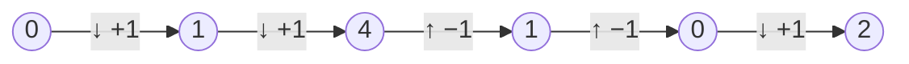

# Euler-Tour Technique on Trees

## What it is
Trees look hard to parallelise because depth-first traversal is sequential. The **Euler-tour technique** converts tree problems into *list problems*, which [list ranking](#/list_ranking) and [parallel prefix](#/parallel_prefix) solve in `O(lg n)` time. It is the standard PRAM method for computing depths, preorder numbers, subtree sizes, and more.

## How it works
1. Replace each tree edge `{u, v}` by two directed edges `(u→v)` and `(v→u)`.
2. Link the directed edges into a single circular list — the **Euler tour** — by defining the successor of `(u→v)` as `(v→w)`, where `w` follows `u` in `v`'s circular adjacency list. This needs only local information, so all successors are computed in `O(1)` parallel time.
3. Cut the cycle at the root to get a linked list of `2(n−1)` edges.
4. Assign weights: `+1` to *downward* edges (parent→child) and `−1` to *upward* edges. A prefix sum along the list at the edge entering `v` equals `depth(v)`.
   With weight 1 on first-time visits you get preorder numbers; weights give subtree sizes as differences of prefix sums.

## Complexity
`O(lg n)` time with `O(n)` processors (EREW), `Θ(n lg n)` work using simple pointer jumping.

## When to use it
Parallel tree computations: depths, LCA queries, subtree aggregates, tree contraction. It underlies many parallel graph algorithms (connectivity, biconnected components).

## In this implementation
The tour is built as a successor array over edge ids (`2v` = down into `v`, `2v+1` = up from `v`), then suffix sums are computed by pointer jumping; depths are checked against a sequential traversal on random trees.
