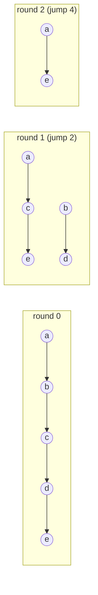

# List Ranking (Pointer Jumping)

## What it is
The first edition of CLRS devoted Chapter 30 to **algorithms for parallel computers** in the **PRAM model** — a shared-memory machine whose processors execute in lock-step. (The chapter was cut from the 2nd edition; the 3rd edition introduced the dynamic-multithreading model instead.) *List ranking* asks for each node of a linked list its distance from the end, something that looks inherently sequential.

## How it works
**Pointer jumping** (a.k.a. recursive doubling): give every node `i` a distance `d[i]` (1 if it has a successor, else 0) and a pointer `next[i]`. In each synchronous step, *every node in parallel* executes

```
d[i]    ← d[i] + d[next[i]]
next[i] ← next[next[i]]
```
so the pointers skip over 1, 2, 4, 8 … nodes. After `⌈lg n⌉` steps every pointer reaches the tail and `d[i]` is the rank.


Correctness invariant: `d[i]` is the number of links between `i` and `next[i]`.

## Complexity
`O(lg n)` time with `n` processors on an EREW PRAM; total work `Θ(n lg n)` (an optimal `O(n)`-work algorithm exists but is more intricate).

## When to use it
It is the building block for many PRAM algorithms: [prefix sums on lists](#/parallel_prefix), the [Euler-tour technique](#/euler_tour_technique) for trees, connected components, and parallel expression evaluation. On GPUs the same doubling idea turns scans into `lg n` kernel launches.

## In this implementation
Each round copies the old arrays first, mimicking the PRAM's read-then-write lock-step semantics; tests compare with a sequential walk and assert `⌈lg n⌉` rounds.
