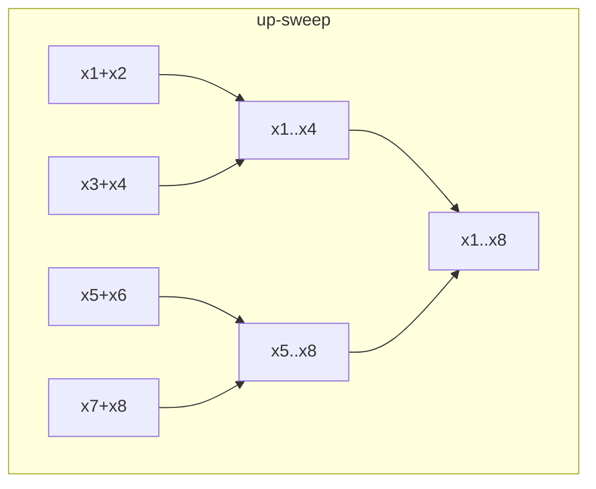

# Parallel Prefix (Scan)

## What it is
Given `x₁,…,xₙ` and an associative operator `⊗`, the **prefix computation** produces `y_k = x₁ ⊗ x₂ ⊗ … ⊗ x_k` for every `k`. Sequentially it is a trivial loop; Section 30.2 of the first edition shows how to compute it in `O(lg n)` parallel time — one of the most useful primitives in parallel computing.

## How it works
**Recursive doubling (pointer jumping on an array).** In step `k`, every processor `i ≥ 2ᵏ` replaces `x_i` by `x_{i−2ᵏ} ⊗ x_i`. After `⌈lg n⌉` steps each position holds its full prefix. Work: `Θ(n lg n)`.

**Work-efficient (Blelloch) scan.** An *up-sweep* builds a balanced tree of partial sums (a reduction); a *down-sweep* pushes prefixes back down. `2 lg n` steps but only `O(n)` operations total.

## Complexity
Doubling: `O(lg n)` time, `n` processors, `Θ(n lg n)` work. Blelloch: `O(lg n)` time, `O(n/lg n)` processors suffices, `Θ(n)` work.

## When to use it
Parallel sorting (radix sort), stream compaction, adder design ([carry-lookahead](#/carry_lookahead_adder) is a prefix computation over carry-propagate pairs!), polynomial evaluation, lexical analysis, and GPU primitives (CUDA `thrust::inclusive_scan`).

## In this implementation
Each round copies the previous values to mimic synchronous reads. The operator is a closure, so sums, maxima, or any associative operation work. Round counts and work are asserted in the tests.
