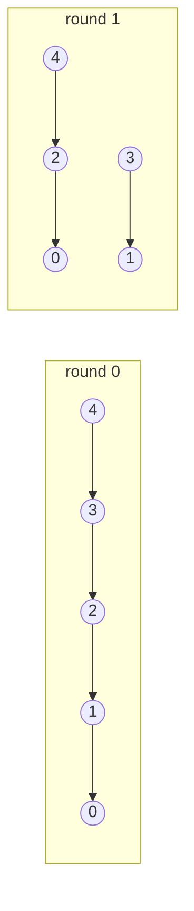

# Pointer Jumping (Finding Roots in a Forest)

## What it is
In a forest represented by parent pointers, finding the root of every node sequentially takes time proportional to the tree height (or total `O(n)` with memoisation). **Pointer jumping** (a.k.a. *recursive doubling*) is the PRAM technique that does it in `O(lg h)` parallel time, `h` being the maximum height. It is the idea behind [list ranking](#/list_ranking) and the [Euler-tour technique](#/euler_tour_technique), which solve many tree problems in `O(lg n)` time on a PRAM.

## How it works
Give every node `v` one processor and repeat synchronously: `parent[v] ← parent[parent[v]]` (each node "jumps" to its grandparent; roots point to themselves and stay fixed). After round `k` every node points to its `2ᵏ`-th ancestor (or its root if closer), so after `⌈lg h⌉` rounds all pointers address the root. All processors read the old array before any writes — an **EREW/CREW** step, since several nodes read the same cell but write distinct ones.

## Complexity
`O(lg h)` time with `n` processors, `O(n lg h)` total work — not work-efficient compared to the `O(n)` sequential bound; work-optimal variants combine it with random mate or coin-tossing contraction.

## When to use it
Parallel graph algorithms (connected components in the Shiloach–Vishkin algorithm uses pointer jumping), GPU union-find, computing depths in trees, prefix computations on linked lists.

## In this implementation
Tests compare with walking each node to its root on 300 random forests (including many roots) and check the round count is at most `⌈lg height⌉ + 1`; a chain of 65 nodes needs exactly 6 rounds.
