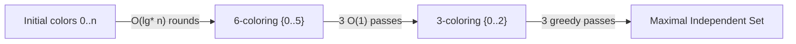

# PRAM Work-Efficient Prefix & Symmetry Breaking

## What it is
Two classic 1st-edition EREW PRAM symmetry-breaking and list-contraction algorithms: deterministic **coin tossing** 6-coloring in $O(\lg^* n)$ parallel rounds (and $O(1)$-round reduction to 3-coloring / maximal independent set), and **randomized list prefix** achieving $O(n)$ total work in $O(\lg n)$ expected time.

## How it works
* **`SIX-COLOR`**: Fix the tail node at color `0` and initialize every other node $u$ to $u + 1$. Each synchronous round replaces $c[u]$ with $2k + \text{bit}_k(c[u])$, where $k$ is the lowest bit position where $c[u]$ and $c[\text{next}[u]]$ differ. Because color bit-widths shrink logarithmically each round, all colors fall into $\{0,\dots,5\}$ within $O(\lg^* n)$ steps while preserving $c[u] \ne c[\text{next}[u]]$.
* **`three_color_from_six`**: Because nodes of any single color form an independent set on paths, eliminating colors `5`, `4`, and `3` in three parallel passes recolors every target node to a color in $\{0,1,2\}$ disjoint from its two neighbors.
* **`randomized_list_prefix`**: Flip coins at active nodes, pair heads with tails to splice out about a quarter of active nodes per round until only $O(n / \lg n)$ remain, run [list ranking](#/list_ranking) on the compressed chain, and splice values back in reverse order.

## Complexity
* Deterministic 6-coloring and 3-coloring: $O(\lg^* n)$ rounds on a list/forest of $n$ nodes.
* Randomized list prefix: $O(n)$ expected total work and $O(\lg n)$ expected parallel time on EREW PRAM.

## When to use it
Whenever an EREW PRAM algorithm needs to break symmetry on anonymous linked lists without worst-case $\Omega(\lg n)$ coloring overhead or $\Theta(n \lg n)$ pointer-jumping work wastage.

## In this implementation
`six_color_list`, `three_color_from_six`, `mis_from_three_coloring`, and `randomized_list_prefix` simulate synchronous parallel steps deterministically via `crate::common::Rng` and verify proper colorings and exact prefix sums against sequential walks.
