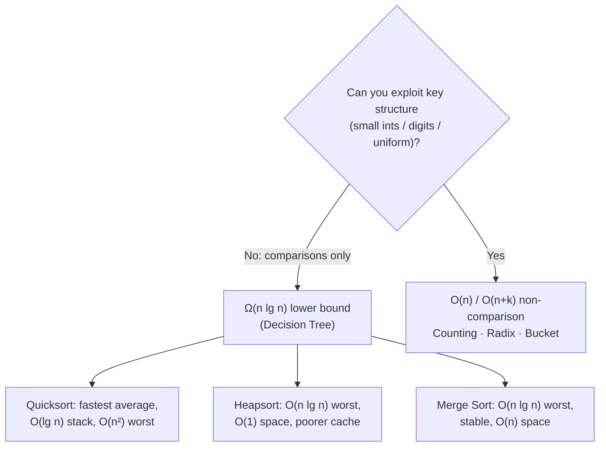

# Sorting & Order Statistics

## Introduction
Sorting puts a collection into order, and order statistics asks for the $k$-th smallest item (like the minimum, maximum, or median). Almost every non-trivial CS system—databases, search engines, graphics pipelines, OS schedulers—depends on sorting or selecting quickly. In Part II of CLRS, you learn why general comparison sorting hits a speed wall at $\Omega(n \lg n)$, when you can break that wall, and how to find the median in linear time *without* sorting the whole array.

## What Problem Is It Solving?
- **Comparison-based sorting:** Reorder $n$ arbitrary items using only `<` comparisons ([Heapsort](#/heapsort), [Quicksort](#/quicksort), [Randomized Quicksort](#/randomized_quicksort), [Quicksort Variants](#/quicksort_variants)).
- **Linear-time sorting:** Exploit extra structure (small integers, fixed-length strings, uniform floats) to beat the $\Omega(n \lg n)$ comparison bound ([Counting Sort](#/counting_sort), [Radix Sort](#/radix_sort), [Bucket Sort](#/bucket_sort), [In-Place Linear Sort](#/in_place_linear_sort)).
- **Parallel/hardware sorting circuits:** Sort with fixed comparator wires whose schedule does not depend on data ([Comparison Networks](#/comparison_network), [Bitonic Sorter](#/bitonic_sorter), [Odd-Even Merge Sort](#/odd_even_merge_sort), [Permutation Networks](#/permutation_network)).
- **Order statistics:** Find the min/max ([Simultaneous Min & Max](#/min_max)) or exact $i$-th order statistic ([Randomized Select](#/randomized_select), [Worst-Case Linear Select](#/select_linear_time), [Weighted Median](#/weighted_median)) faster than sorting.

## Algorithms & Trade-Offs

| Algorithm | Time (Avg / Worst) | Extra Space | Stable? | Key Trade-Off |
|---|---|---|---|---|
| [Quicksort](#/quicksort) / [Randomized Quicksort](#/randomized_quicksort) | $\Theta(n \lg n)$ exp. / $\Theta(n^2)$ worst | $O(\lg n)$ stack | No | Fastest in practice due to sequential cache scans and tiny inner loop. Randomizing pivots ([Randomized Quicksort](#/randomized_quicksort)) or 3-way partitioning ([Quicksort Variants](#/quicksort_variants)) avoids sorted-input blowups. |
| [Heapsort](#/heapsort) | $\Theta(n \lg n)$ / $\Theta(n \lg n)$ | $O(1)$ | No | Gives strict $O(n \lg n)$ worst case and zero heap allocation, **but** jumps around memory (`2i+1`), making it slower than Quicksort on modern caches. |
| [Counting Sort](#/counting_sort) | $\Theta(n + k)$ | $\Theta(n + k)$ | Yes | Linear time when keys live in $0..k$ with $k = O(n)$, **but** blows up memory if $k \gg n$. See [In-Place Linear Sort](#/in_place_linear_sort) for the 3-way trade-off between $O(n)$ time, stability, and $O(1)$ space. |
| [Radix Sort](#/radix_sort) | $\Theta(d(n + b))$ | $\Theta(n + b)$ | Yes | Beats comparison sorts on fixed-width keys (`u64`, fixed strings) by doing $d$ stable passes of base $b$. |
| [Bucket Sort](#/bucket_sort) | $\Theta(n)$ expected / $\Theta(n^2)$ worst | $\Theta(n)$ | Yes | Linear when inputs are uniformly distributed; degrades if all keys collide into one bucket. |
| [Randomized Select](#/randomized_select) vs. [Linear Select](#/select_linear_time) | $\Theta(n)$ exp. vs. $\Theta(n)$ worst | $O(1)$–$O(\lg n)$ | — | Both find the $k$-th smallest element without sorting. Median-of-medians ([Linear Select](#/select_linear_time)) guarantees $O(n)$ worst case, **but** its constant factor is high enough that Quickselect ([Randomized Select](#/randomized_select)) wins in almost all real code. |

## Quick Rules of Thumb for CS Students
- **Why $\Omega(n \lg n)$ is a law of nature for comparisons:** [Decision-Tree Lower Bound](#/decision_tree_lower_bound) shows any comparison sort needs $\lg(n!) = \Theta(n \lg n)$ comparisons in the worst case—so when you see an $O(n)$ sort, *always* ask what non-comparison assumption made it possible!
- **Need top-$k$ or streaming max?** Don't sort; use a [Priority Queue](#/heap_priority_queue) (`BUILD-MAX-HEAP` takes $\Theta(n)$, not $\Theta(n \lg n)$!) or [Simultaneous Min & Max](#/min_max) ($3\lfloor n/2\rfloor$ comparisons instead of $2n$).
- **Need stability *and* speed?** Remember [In-Place Linear Sort](#/in_place_linear_sort): you normally cannot get linear time, stability, *and* $O(1)$ extra space simultaneously without specialized tricks.
