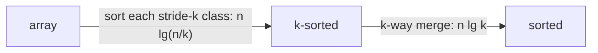

# Average Sorting (k-Sorted Arrays)

## What it is
Sometimes we only need the elements of an array to *increase on average*. Problem 8-5 calls `A[1..n]` **k-sorted** if for all `i` the average of the window `A[i..i+k−1]` is at most the average of the next window `A[i+1..i+k]`. Cancelling the shared terms shows this is the same as **`A[i] ≤ A[i+k]` for all `i`**: each of the `k` subsequences taken with stride `k` is sorted. A 1-sorted array is sorted; a `k`-sorted array with `k ≥ n` is any array.

## How it works
* **k-sorting in `O(n lg(n/k))`.** The `k` stride-`k` subsequences have `n/k` elements each; sort each independently ([merge sort](#/merge_sort) or [heapsort](#/heapsort)): `k · (n/k) lg(n/k) = n lg(n/k)`.
* **Fully sorting a k-sorted array in `O(n lg k)`.** The array is a set of `k` already sorted lists, so a **`k`-way merge** with a min-heap of size `k` ([priority queue](#/heap_priority_queue)) produces the sorted order: `n` extractions of cost `lg k`.
* **Lower bound.** The number of distinct `k`-sorted permutations is large enough that any comparison sort of a `k`-sorted array needs `Ω(n lg k)` comparisons, so the merge is optimal. Together the two phases `O(n lg(n/k)) + O(n lg k) = O(n lg n)` recover the usual bound for full sorting.

## Complexity
`O(n lg(n/k))` to k-sort, `O(n lg k)` to finish; `Ω(n lg k)` to sort a k-sorted array.

## When to use it
Approximately sorted data (timestamps from `k` interleaved sources, nearly ordered log streams), and as the building block of external merge sorts, where `k` runs are merged with a heap.

## In this implementation
`is_k_sorted` tests `A[i] ≤ A[i+k]`; `k_sort` sorts the residue classes; `sort_k_sorted` is the heap-based `k`-way merge. Tests check, on 200 random arrays each, that `k_sort` yields a `k`-sorted permutation and that merging a `k`-sorted array equals `std` sorting.
