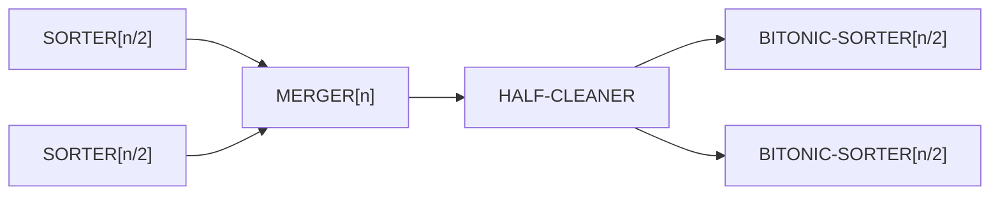

# Bitonic Sorting Network

## What it is
A **bitonic sequence** first monotonically increases and then monotonically decreases (or is a cyclic shift of such a sequence). Batcher's bitonic sorter sorts any such sequence with a network of depth `lg n`; stacked recursively it yields a full sorting network of depth `Θ(lg² n)`.

## How it works
* **HALF-CLEANER[n]** compares `i` with `i + n/2` for `i < n/2`. For a bitonic input, *every* element of the upper half is ≤ *every* element of the lower half, and both halves are bitonic.
* **BITONIC-SORTER[n]** = half-cleaner followed by two BITONIC-SORTER[n/2] in parallel. Depth `lg n`.
* **MERGER[n]** merges two *sorted* sequences: flip the second half (compare `i` with `n−1−i`), which produces two bitonic halves, then bitonic-sort each.
* **SORTER[n]** = two SORTER[n/2] in parallel, followed by MERGER[n].

## Complexity
Depth `lg n (lg n + 1)/2`, size `(n/4) lg n (lg n + 1)`, i.e. `Θ(lg² n)` depth with `Θ(n lg² n)` comparators.

## When to use it
Sorting on GPUs, SIMD units and FPGAs: the regular, data-independent structure maps well to hardware, even though AKS networks are asymptotically deeper-optimal (O(lg n) depth) but impractical. Requires `n` a power of two (pad with +∞ otherwise).

## In this implementation
`bitonic_sorting_network(n)` returns a [`Network`](#/comparison_network); tests verify it with the 0-1 principle and check depth/size against the closed forms.
