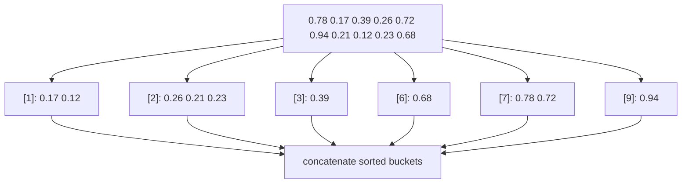

# Bucket Sort

## What it is
Bucket sort assumes the input is drawn from a **uniform distribution** on `[0, 1)` and sorts it in expected linear time — another way to beat the Ω(n lg n) comparison bound.

## How it works
1. Create `n` empty buckets; put `A[i]` in bucket `⌊n·A[i]⌋`.
2. Sort each bucket with [insertion sort](#/insertion_sort).
3. Concatenate the buckets in order.

Let `nᵢ` be the size of bucket `i`. Expected cost is `Θ(n) + Σ E[nᵢ²] = Θ(n) + n·(2 − 1/n) = Θ(n)`.

## Complexity
Expected Θ(n) under uniformity; worst case Θ(n²) (all keys in one bucket) or Θ(n lg n) if buckets are sorted with a better algorithm.

## When to use it
Floating-point data known to be roughly uniform, or any data whose distribution you can map to uniform (e.g. by a CDF). Related to hashing with chaining ([hash tables](#/chained_hash_table)).

## In this implementation
`bucket_sort` works on `f64` in `[0,1)`; `max_bucket` measures load balance.
