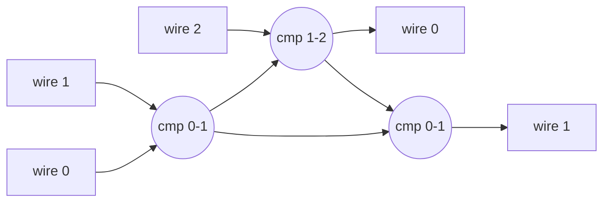

# Comparison Networks & the 0-1 Principle

## What it is
The first and second editions devoted a chapter to **sorting networks** — circuits built from **comparators**, each taking two wires and putting the minimum on the upper wire and the maximum on the lower. Unlike a comparison *algorithm*, the sequence of comparisons is fixed in advance and independent of the data, so comparators on disjoint wires can run in parallel (a natural fit for hardware). The 3rd edition removed the chapter.

## How it works
* **Size** = number of comparators; **depth** = number of parallel steps (longest path).
* **Zero-one principle:** a comparison network that sorts all `2ⁿ` sequences of 0s and 1s sorts every input. This reduces correctness proofs (and brute-force verification) from infinitely many inputs to `2ⁿ`.

Two simple sorting networks are included: **insertion sort** (size n(n−1)/2, depth 2n−3) and **odd-even transposition** (depth n). Both have poor depth compared with [bitonic](#/bitonic_sorter) and [odd-even merge](#/odd_even_merge_sort) networks, which achieve O(lg² n).

## Complexity
Verification by the 0-1 principle: O(2ⁿ · size). The network itself runs in `depth` parallel steps.

## When to use it
Hardware sorters (FPGA/ASIC), GPU kernels and SIMD register sorting, where data-independent control flow avoids branches. Ties in nicely with RTL design: each comparator is a magnitude comparator plus two muxes.

## In this implementation
`Network` stores comparators `(i, j)` with the minimum on `i`; `is_sorting_network` implements the 0-1 principle exhaustively (≤ 22 wires).
