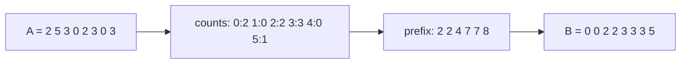

# Counting Sort

## What it is
Comparison sorts need Ω(n lg n) comparisons (decision-tree lower bound, Section 8.1). Counting sort sidesteps the bound by **not comparing**: if the keys are integers in `0…k` it sorts in Θ(n + k) time.

## How it works
1. `C[i]` ← number of elements equal to `i`.
2. Prefix sums make `C[i]` = number of elements `≤ i`, i.e. the last output position of key `i`.
3. Scan the input **right to left**, placing each element at `B[C[A[j]]]` and decrementing the counter. The right-to-left scan makes the sort **stable**, which [radix sort](#/radix_sort) relies on.

## Complexity
Θ(n + k) time and space. Linear when `k = O(n)`.

## When to use it
Small integer key ranges (ages, grades, byte values), as the digit-sorting subroutine of radix sort, and for answering "how many keys fall in `[a, b]`" in O(1) after preprocessing (Exercise 8.2-4, implemented as `RangeCounter`).

## In this implementation
`counting_sort_by_key` sorts any `Clone` records by a `usize` key and is stable — verified in the tests.
