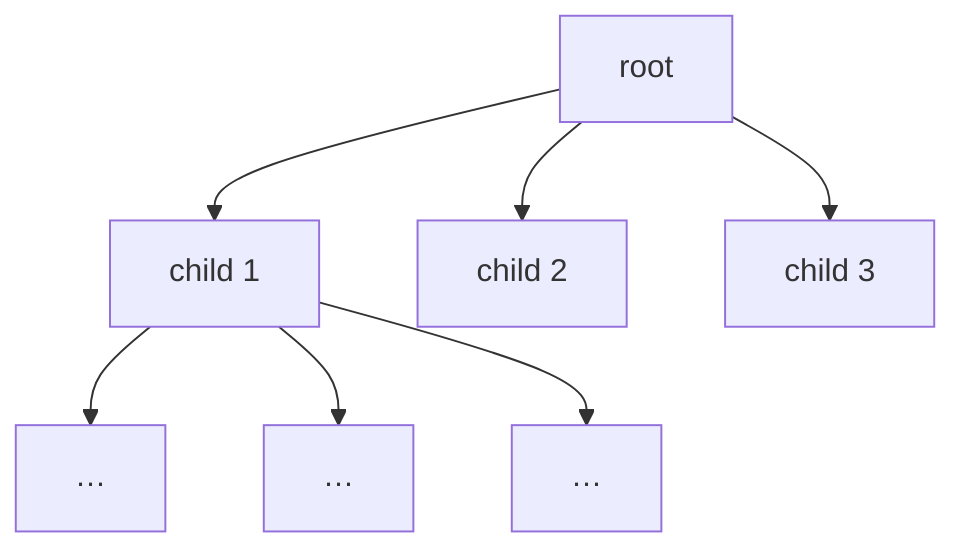

# d-ary Heap

## What it is
Problem 6-2 generalises the binary heap to a tree in which every internal node has `d` children. The array layout is the same idea: the children of index `i` are `d·i+1, …, d·i+d` and the parent is `⌊(i−1)/d⌋` (0-based).

## How it works
Larger `d` makes the tree **shallower** — height `Θ(log_d n)` — but each sift-down must examine `d` children.

## Complexity
| Operation | Time |
|---|---|
| INSERT, INCREASE-KEY | Θ(log_d n) |
| EXTRACT-MAX | Θ(d · log_d n) |

Choosing `d ≈ m/n` (edges/vertices) makes [Dijkstra](#/dijkstra)/[Prim](#/mst_prim) run in `O(m log_{m/n} n)`, matching Fibonacci heaps asymptotically for dense graphs.

## When to use it
When decrease-key/insert dominates extract-min (graph algorithms on dense graphs), or when a wider fan-out improves cache behaviour (4-ary heaps are common in practice).

## In this implementation
`DaryHeap` supports `insert`, `extract_max`, `increase_key` and reports its `height`, which the tests compare with the closed form `⌈log_d(n(d−1)+1)⌉ − 1`.
