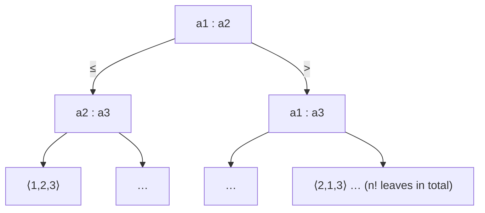

# Comparison-Sort Lower Bound

## What it is
[Merge sort](#/merge_sort) and [heapsort](#/heapsort) sort in `O(n lg n)` comparisons. Section 8.1 proves this is **optimal** for any algorithm that sorts by comparing elements: every such algorithm needs `Ω(n lg n)` comparisons in the worst case (and on average).

## How it works
Model any comparison sort as a **decision tree**: each internal node is a comparison `aᵢ : aⱼ`, each leaf a permutation of the input that the algorithm outputs. The tree must have **at least `n!` leaves** — one per possible ordering — because otherwise two different inputs would reach the same leaf and be given the same (incorrect for one of them) output. A binary tree of height `h` has at most `2^h` leaves, so

`2^h ≥ n!  ⇒  h ≥ lg(n!) = Θ(n lg n)` (Stirling: `lg n! = n lg n − n lg e + O(lg n)`).

The *average* depth of a leaf is also `≥ lg n!` (a balanced tree minimises it). The bound explains why [counting](#/counting_sort), [radix](#/radix_sort) and [bucket sort](#/bucket_sort) can be faster: they do not compare elements.

## Complexity
Worst case `⌈lg n!⌉` comparisons: 0, 1, 3, 5, 7, 10, 13, 16 for `n = 1…8`.

## When to use it
It tells you when to stop optimising a comparison sort, and it is the template for other lower bounds (merging, selection, searching).

## In this implementation
A `Counted` key increments a counter on every comparison, so the library's own insertion, merge, heap and quick sorts are measured over **all** `n!` permutations (n ≤ 7) and checked against `⌈lg n!⌉`; merge sort hits the bound exactly for `n = 4`.
