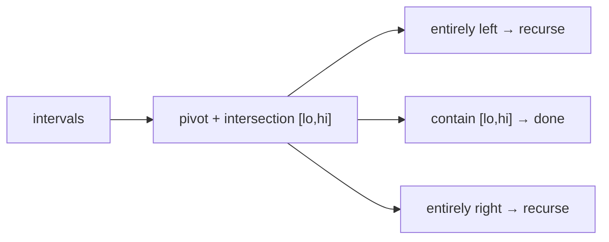

# Fuzzy Sorting of Intervals

## What it is
Instead of exact numbers we are given `n` closed **intervals** `[aᵢ, bᵢ]`. They are **fuzzy-sorted** if we can choose points `cᵢ ∈ [aᵢ, bᵢ]` so that `c₁ ≤ c₂ ≤ … ≤ cₙ`. Overlapping intervals can appear in any relative order, which gives room for speed: the algorithm of Problem 7-6 runs in expected `Θ(n lg n)` in general and `Θ(n)` when all intervals overlap.

## How it works
A modified [randomized quicksort](#/randomized_quicksort):
1. Pick a random **pivot interval** and compute (`FIND-INTERSECTION`) the intersection `[lo, hi]` of the pivot with every interval that still overlaps the growing intersection; every interval examined this way contains the final `[lo, hi]`.
2. Partition into **left** (entirely before `lo`), **right** (entirely after `hi`) and **middle** (everything that contains `[lo, hi]`).
3. Recurse on left and right; the middle intervals all share a point so they may stay in any order.

If all intervals overlap, one pass puts everything in the middle: `Θ(n)`. If they are disjoint the algorithm degenerates to ordinary quicksort.

## Complexity
Expected `Θ(n lg n)`; `Θ(n)` when intervals overlap heavily (the middle part is never recursed on).

## When to use it
Sorting uncertain measurements (tolerance intervals, time windows) where only a consistent ordering is required, and as a template for exploiting ties in quicksort ([three-way partitioning](#/quicksort_variants)).

## In this implementation
`is_fuzzy_sorted` checks the definition greedily (take the smallest feasible point each time); 500 random instances confirm correctness and permutation preservation.
