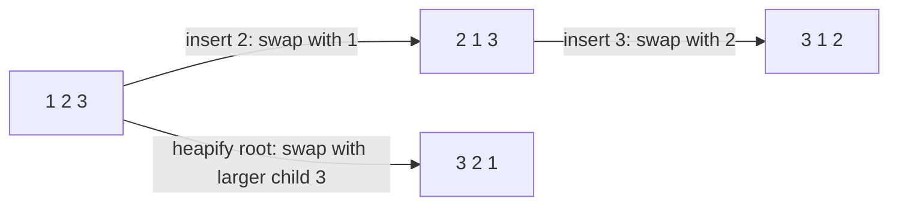

# Building a Heap by Insertion vs. BUILD-MAX-HEAP

## What it is
[Heapsort](#/heapsort)'s `BUILD-MAX-HEAP` heapifies from the bottom up in `Θ(n)`. Problem 6-1 considers the obvious alternative, `BUILD-MAX-HEAP′`, which builds the heap by calling `MAX-HEAP-INSERT` on each element in turn, and asks you to compare them.

## How it works
* **Insertion version:** element `i` sifts **up** along a path of length up to `⌊lg i⌋`. For increasing input every element climbs to the root: `Σ lg i = Θ(n lg n)` swaps. (A matching `Ω(n lg n)` lower bound shows the analysis is tight.)
* **Bottom-up version:** most nodes are near the leaves and sift down only a short distance: `Σ_h ⌈n/2^{h+1}⌉·h = O(n)`.
* The two procedures **do not always create the same heap**: for `⟨1, 2, 3⟩` insertion gives `⟨3, 1, 2⟩` while heapify gives `⟨3, 2, 1⟩`.

## Complexity
Insertion build `Θ(n lg n)` worst case; bottom-up build `Θ(n)`.

## When to use it
Bottom-up heapify whenever all data is available at once (heapsort, `heapq.heapify`); insertion when elements arrive online ([priority queue](#/heap_priority_queue)).

## In this implementation
Both builders count swaps; tests assert validity, that results differ for many random inputs, and that ascending input shows the `n lg n` versus `n` gap.
