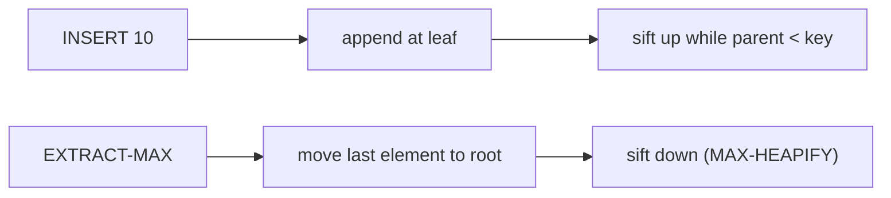

# Priority Queue (Binary Heap)

## What it is
A **max-priority queue** maintains a set `S` of keyed elements and supports `INSERT`, `MAXIMUM`, `EXTRACT-MAX` and `INCREASE-KEY`. The binary heap of [heapsort](#/heapsort) implements all of them in O(lg n); a min-priority queue is symmetric.

## How it works
* `INSERT` appends at the end and **sifts up** while the parent is smaller.
* `EXTRACT-MAX` swaps the root with the last element, removes it, and **sifts down** the new root.
* `INCREASE-KEY(i, k)` overwrites the key and sifts up.
* `DELETE(i)` (Exercise 6.5-8) swaps with the last element then repairs in whichever direction is needed.

## Complexity
| Operation | Time |
|---|---|
| MAXIMUM | Θ(1) |
| INSERT, EXTRACT-MAX, INCREASE-KEY, DELETE | O(lg n) |
| Build from n items | Θ(n) |

## When to use it
Job scheduling, event-driven simulation, Huffman coding ([greedy](#/huffman)), [Dijkstra](#/dijkstra), [Prim](#/mst_prim), and k-way merging (Exercise 6.5-9: merge `k` sorted lists in O(n lg k)).

## In this implementation
`PriorityQueue<T>` is generic over `PartialOrd`; wrapping keys in `std::cmp::Reverse` gives a min-queue, which `merge_sorted_lists` uses.
