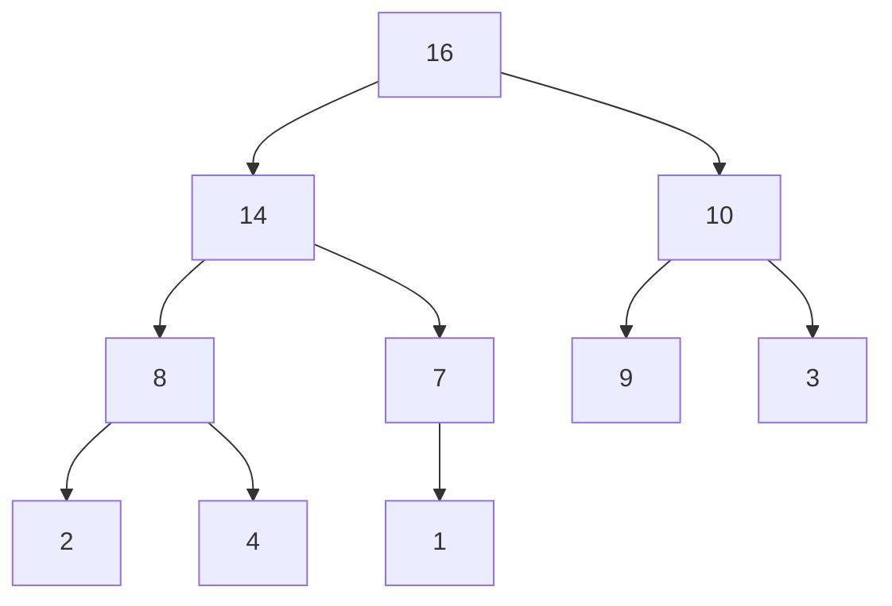

# Heapsort

## What it is
Heapsort combines the best properties of merge sort (Θ(n lg n) worst case) and insertion sort (in place). It is built on the **binary heap**: an array viewed as a nearly complete binary tree in which every parent is at least as large as its children (max-heap property). With 0-based indexing, the children of `i` are `2i+1` and `2i+2`.

## How it works
* `MAX-HEAPIFY(A, i)` — swap `A[i]` with its larger child until the heap property holds below `i`. O(lg n).
* `BUILD-MAX-HEAP(A)` — call `MAX-HEAPIFY` on `⌊n/2⌋−1 … 0`. Surprisingly **Θ(n)**, not Θ(n lg n), because most nodes are near the leaves.
* `HEAPSORT(A)` — build the heap; swap the root (maximum) with the last element, shrink the heap by one, restore with `MAX-HEAPIFY`; repeat.

Array form: `[16, 14, 10, 8, 7, 9, 3, 2, 4, 1]`.

## Complexity
Θ(n lg n) in all cases, O(1) extra space, not stable. `BUILD-MAX-HEAP` is Θ(n).

## When to use it
Guaranteed worst-case time with no extra memory (embedded systems); the heap itself is the standard [priority queue](#/heap_priority_queue). Quicksort is usually faster in practice because of cache behaviour.

## In this implementation
`max_heapify` takes an explicit `heap_size` as in the pseudocode; the book's Figure 6.2 example is a unit test.
