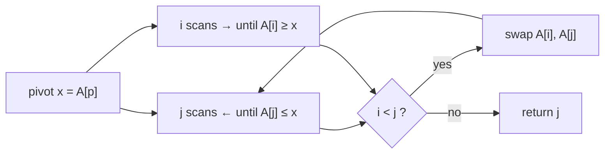

# Hoare Partition Quicksort

## What it is
The first edition of CLRS presented C. A. R. Hoare's **original 1962 partition**: two indices sweep inward from the ends and exchange out-of-place elements. Later editions switched to the simpler [Lomuto scheme](#/quicksort) and kept Hoare's as Problem 7-1.

## How it works
With pivot `x = A[p]`: move `j` leftward until `A[j] ≤ x`, move `i` rightward until `A[i] ≥ x`; if `i < j` swap and continue, otherwise return `j`. The result satisfies `A[p..j] ≤ x ≤ A[j+1..r]`. The recursion then sorts `A[p..j]` and `A[j+1..r]`, **not** excluding the pivot (it need not end at index `j`).

## Complexity
Θ(n) per partition with about `n/6` swaps on average (Lomuto does about `n/2`); the same Θ(n lg n) expected / Θ(n²) worst case as quicksort. It handles runs of equal keys well because both pointers stop on equal elements.

## When to use it
Performance-critical quicksorts (most library sorts use a Hoare-style scan). Beware: choosing the *last* element as pivot with this scheme can loop forever — the first element is correct for this variant.

## In this implementation
`hoare_partition` mirrors Problem 7-1; tests verify the split property and sort arrays with many duplicates.
