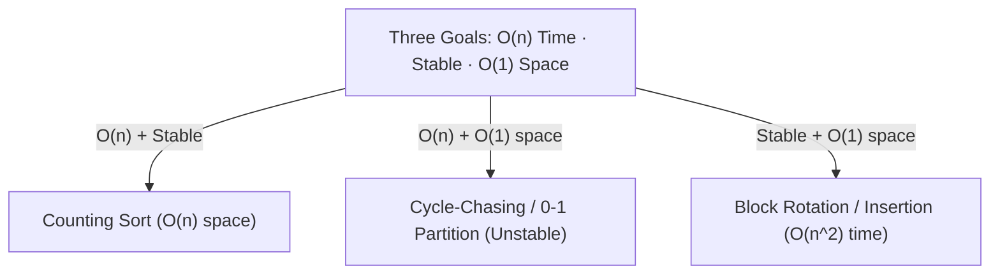

# Sorting in Place in Linear Time

## What it is
An exploration of the three-way trade-off posed in CLRS Problem 8-2 for sorting $n$ records with keys in $\{0,\dots,k\}$:
1. $O(n)$ worst-case running time,
2. **Stability** (equal keys preserve input order), and
3. **$O(1)$ auxiliary space** (sorting in place).

No single comparison-free method cleanly optimizes all three simultaneously without restricting $k$ or paying quadratic shift cost.

## How it works
* **Stable $O(n + k)$ (`stable_linear_sort`)**: Delegates to [counting sort](#/counting_sort), using an auxiliary output array of size $n$ and scanning backward so equal keys remain in original order.
* **In-place $O(n)$ 0–1 partition (`in_place_binary_partition`)**: Hoare-style two-pointer swap moves all `0`s before `1`s in $O(1)$ extra space, breaking stability.
* **In-place stable 0–1 sort (`stable_in_place_binary_sort`)**: Rotates contiguous `1`-blocks right whenever a `0` arrives, preserving ties in $O(1)$ space at $\Theta(n^2)$ worst-case time.
* **In-place cycle-chasing counting sort (`in_place_counting_sort`)**: Computes bucket cursor bounds `[pos[v], limit[v])` using $O(k)$ space (which is $O(1)$ extra space when $k = O(1)$) and swaps each element directly into its target bucket cursor, reordering ties.
* **In-place MSD binary [radix sort](#/radix_sort) (`in_place_msd_radix_sort`)**: Recursively partitions on bit $b-1$ down to bit $0$ using the $O(1)$-space binary partition in $O(bn)$ time and $O(b)$ call stack.

## Complexity
| Variant | Time | Extra Space | Stable |
|---|---|---|---|
| `stable_linear_sort` | $\Theta(n+k)$ | $\Theta(n+k)$ | Yes |
| `in_place_binary_partition` | $\Theta(n)$ | $\Theta(1)$ | No |
| `stable_in_place_binary_sort` | $\Theta(n^2)$ | $\Theta(1)$ | Yes |
| `in_place_counting_sort` | $\Theta(n+k)$ | $\Theta(k)$ | No |
| `in_place_msd_radix_sort` | $\Theta(bn)$ | $O(b)$ stack | No |

## When to use it
Use auxiliary [counting sort](#/counting_sort) when stability is required (for LSD [radix sort](#/radix_sort)), or cycle-chasing / MSD binary partitioning when memory is constrained and tie order is irrelevant.

## In this implementation
`in_place_linear_sort.rs` implements all five variants with satellite tags `(key, payload)` and asserts both key ordering against `slice::sort` and stability/permutation invariants across randomized small-key and multi-bit inputs.
