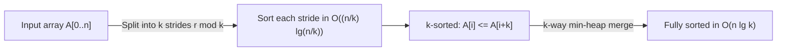

# Average Sorting (k-Sorted Arrays)

## What it is
An array $A[0..n]$ is **$k$-sorted** if the average of every contiguous window of length $k$ is nondecreasing:
$$\frac{1}{k}\sum_{j=i}^{i+k-1} A[j] \le \frac{1}{k}\sum_{j=i+1}^{i+k} A[j] \quad \text{for all } 0 \le i \le n - k - 1.$$
Canceling the shared $k-1$ terms shows that $A$ is $k$-sorted if and only if $A[i] \le A[i+k]$ for every $i$.

## How it works
1. **Constructing a $k$-sorted array (`k_sort`)**: Partition the indices into $k$ strided residue classes $\{r, r+k, r+2k, \dots\}$ for $r = 0, \dots, k-1$. Each class has length $\le \lceil n/k \rceil$ and can be sorted independently in $O((n/k)\lg(n/k))$ time.
2. **Completely sorting a $k$-sorted array (`merge_k_sorted`)**: Because each residue class is already sorted, a $k$-way min-heap merge (like [heap priority queue](#/heap_priority_queue)) merges all $k$ streams into sorted order in $O(n \lg k)$ time — also proving a decision-tree lower bound of $\Omega(n \lg(n/k))$ for $k$-sorting when combined with merging.

## Complexity
* **`k_sort`**: $O(n \lg(n/k))$ time, which drops to $O(n)$ when $k = \Theta(n)$ and matches $O(n \lg n)$ when $k = 1$.
* **`merge_k_sorted`**: $O(n \lg k)$ time and $O(k)$ heap workspace (plus output vector).
* **`is_k_sorted`**: $\Theta(n)$ linear verification.

## When to use it
Whenever partial ordering with bounded sliding-window monotonicity suffices — or as a two-phase sorting pipeline splitting $n$ items into $k$ sorted arithmetic progressions before $k$-way merging.

## In this implementation
`k_sort`, `merge_k_sorted`, and `is_k_sorted` validate both the elementwise $A[i] \le A[i+k]$ condition and the sliding-window sum monotonicity invariant against `slice::sort` across randomized $(n, k)$ pairs.
