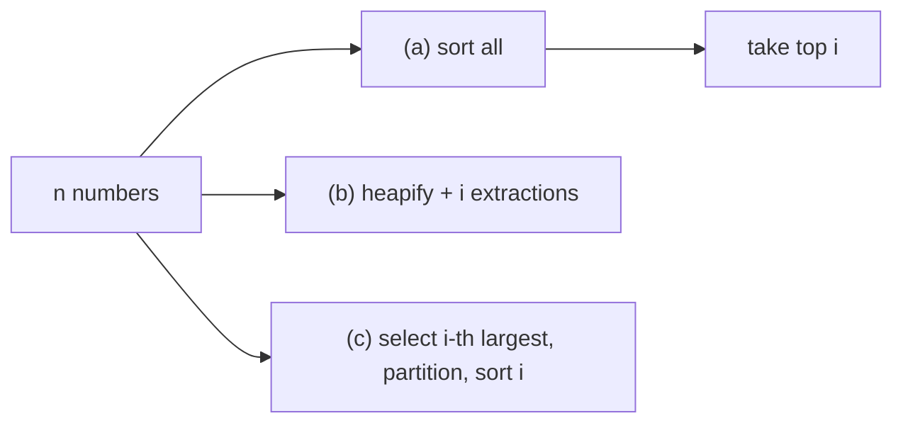

# The i Largest Numbers in Sorted Order

## What it is
Given `n` numbers, list the `i` largest in sorted order. Problem 9-1 compares three natural approaches using the tools of Part II — a good exercise in choosing an algorithm by the *relationship between `i` and `n`*.

## How it works
| Method | Idea | Time |
|---|---|---|
| (a) sort | sort all numbers, take the top `i` | `Θ(n lg n)` |
| (b) heap | [build a max-heap](#/heapsort), call `EXTRACT-MAX` `i` times | `Θ(n + i lg n)` |
| (c) selection | find the `i`-th largest with [SELECT](#/select_linear_time), partition around it, sort only the `i` winners | `Θ(n + i lg i)` |

Method (c) is asymptotically best; (b) is simplest and usually fastest in practice for small `i`. The three coincide at `i = Θ(n)` (all `Θ(n lg n)`).

## Complexity
See the table; space `Θ(n)` for all three (or `O(i)` for a size-`i` min-heap streaming variant).

## When to use it
Top-k queries: leaderboards, search ranking, "k nearest" candidates — streaming implementations keep a min-heap of size `k` for `O(n lg k)`.

## In this implementation
Ties are handled (`by_order_statistic` repeats the threshold value the right number of times); all three methods are cross-checked on 200 random inputs including `i = 0` and `i > n`.
