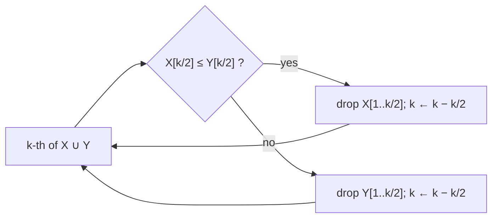

# Median of Two Sorted Arrays

## What it is
Two sorted arrays `X` and `Y` of `n` elements each hold `2n` numbers in total. Exercise 9.3-8 asks for their **median** in `O(lg n)` time — far less than merging (`Θ(n)`), because both inputs are already sorted.

## How it works
Generalise to the **k-th smallest** of the union. Compare the `⌊k/2⌋`-th element of each array (`x = X[k/2]`, `y = Y[k/2]`). If `x ≤ y`, the first `k/2` elements of `X` are all smaller than at least `k − 1` ... more precisely they cannot be the (k+1)-th or larger, so they are all among the `k` smallest and can be **discarded**, after which we look for the `(k − k/2)`-th smallest of the remainder. Symmetric if `y < x`. Each step removes about `k/2` elements, and `k` halves, so `O(lg k)` steps.

Base cases: one array empty (index directly) or `k = 1` (smaller of the two heads). The median is the `n`-th smallest (lower median) of the union.

## Complexity
`O(lg n)` comparisons and `O(1)` extra space (the slices are views, no copying).

## When to use it
Merging two statistics from partitions or shards (combine sorted samples), database `LIMIT/OFFSET` over two sorted indexes, and as a gateway to selection over sorted rows/columns (cf. [Monge arrays](#/monge_arrays)). For one unsorted array use [randomized select](#/randomized_select).

## In this implementation
`kth_of_two` handles unequal lengths; tests compare **every** rank against the merged array for 300 random pairs, plus the equal-length median for `n < 60`.
