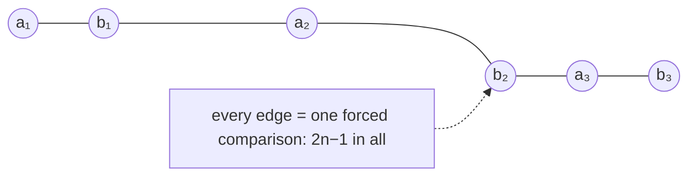

# Lower Bounds for Merging

## What it is
[Merging](#/merge_sort) two sorted sequences of length `n` takes at most `2n − 1` comparisons with the usual linear-time procedure. Problem 8-6 asks how many are **necessary**. The decision-tree argument of [comparison-sort lower bounds](#/decision_tree_lower_bound) gives a first answer, and an **adversary argument** gives the exact one.

## How it works
* **Information-theoretic bound.** The merged order can be any of the `C(2n, n)` ways of interleaving the two lists, so the decision tree has that many leaves and height at least `lg C(2n, n) = 2n − ½ lg n − O(1)` by Stirling's approximation. This is *almost* `2n − 1` but not quite.
* **Adversary bound.** Take `a₁ < b₁ < a₂ < b₂ < … < aₙ < bₙ`. If an algorithm never compared two elements adjacent in the final order, say `aᵢ` and `bᵢ`, then swapping their values gives a different input that is consistent with every comparison the algorithm made, so it would produce a wrong answer for one of the two. Hence each of the `2n − 1` adjacent pairs is compared: **`2n − 1` comparisons are necessary**, and the linear merge is optimal.
* (Merging two lists of *unequal* sizes `m ≪ n` is different: `Θ(m lg(n/m))` comparisons suffice, e.g. by binary-search insertion.)

## Complexity
Exactly `2n − 1` comparisons in the worst case for equal-size lists; the decision-tree bound is `2n − Θ(lg n)`.

## When to use it
To justify that merge sort's merge step cannot be improved by a clever comparison strategy, and as the standard example where an adversary argument beats information theory.

## In this implementation
`merge_counting` records which values were compared. Tests check that on the adversary input every adjacent pair of values is directly compared, that no input needs `la + lb` or more comparisons, and that `lg C(2n,n)` stays within `½ lg n + 2` of `2n` for `n ≤ 200`.
