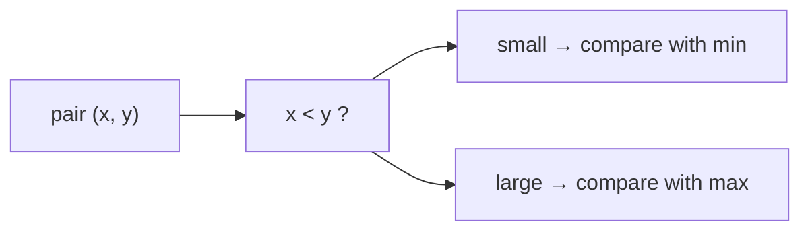

# Simultaneous Minimum and Maximum

## What it is
Section 9.1 asks how many comparisons are needed to find both the smallest and largest of `n` elements. Doing two independent scans costs `2(n−1)`; a smarter scheme needs only about **3n/2**, and this is optimal.

## How it works
Process elements in **pairs**:
1. Compare the two elements of the pair with each other (1 comparison).
2. Compare the *smaller* with the current minimum and the *larger* with the current maximum (2 comparisons).

That is 3 comparisons per 2 elements instead of 4. If `n` is odd, initialise both min and max with the first element; if even, initialise from the first pair (1 comparison).

## Complexity
At most `3⌊n/2⌋` comparisons (`3n/2 − 2` for even n). Also Θ(n) time, O(1) space.

## When to use it
A neat example of a lower-bound-matching algorithm; the same pairing idea speeds up tournament-style selection and min/max in streaming data. For order statistics in general see [randomized select](#/randomized_select) and [worst-case linear select](#/select_linear_time).

## In this implementation
`min_and_max` returns the comparison count so the tests can assert the bound; `minimum` is the single-extreme `n−1` baseline.
