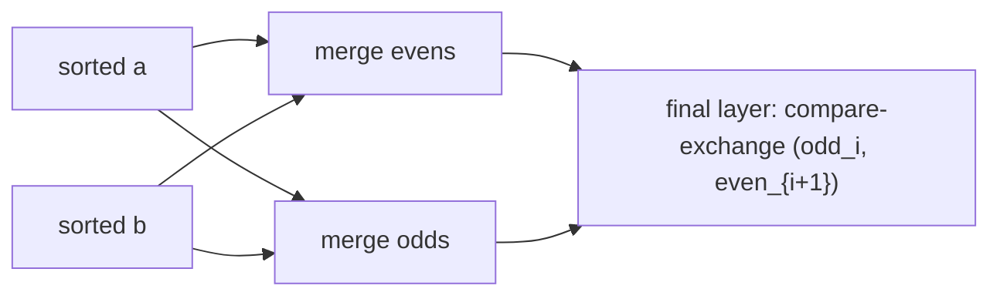

# Odd-Even Merging Network

## What it is
Batcher's second classic network (the first-edition chapter on sorting networks, and Problem 27-5 in the second) merges two sorted sequences by recursively merging their **odd-indexed** and **even-indexed** elements, then fixing up with one layer of comparators. Plugged into the usual "sort both halves, then merge" scheme it gives a sorting network with the same `Θ(lg² n)` depth as [bitonic sorting](#/bitonic_sorter) but noticeably **fewer comparators**.

## How it works
To merge sorted `a` and `b`:
1. Recursively merge the even-indexed elements of both lists → `v`.
2. Recursively merge the odd-indexed elements of both lists → `w`.
3. Interleave `v` and `w` and compare adjacent pairs `(w_i, v_{i+1})`.

## Complexity
Depth `lg n (lg n + 1)/2`; size `Θ(n lg² n)` with a smaller constant than bitonic sort (for n = 32: 191 vs 240 comparators).

## When to use it
Hardware and parallel sorting where comparator count (area) matters. The correctness argument again rests on the [0-1 principle](#/comparison_network).

## In this implementation
`odd_even_merge_sort_network(n)` builds the full sorter, `odd_even_merging_network(n)` just the merger; the tests assert zero-one correctness and the comparator-count advantage.
