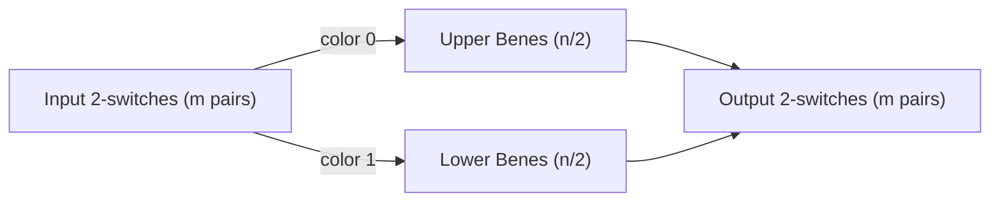

# Transposition & Permutation Networks

## What it is
Two parallel oblivious routing/sorting networks from the 1st and 2nd editions' sorting networks chapters (extending [comparison network](#/comparison_network) and [odd-even merge sort](#/odd_even_merge_sort)):
1. **Odd-Even Transposition Sort**: A fixed $\Theta(n)$-depth sorting network alternating even-indexed `(2k, 2k+1)` and odd-indexed `(2k+1, 2k+2)` compare-exchange stages.
2. **Beneš / Waksman Permutation Network**: A rearrangeable 2-switch routing network of depth $2\lg n - 1$ and $\Theta(n \lg n)$ binary switches capable of realizing **every** permutation $\pi \in S_n$ ($n = 2^k$).

## How it works
* **Odd-even transposition (`odd_even_transposition_sort`)**: Each phase runs disjoint neighbor compare-exchanges in parallel. By the zero-one principle, in worst-case `(0,...,0,1)` or `(1,0,...,0)` a `1` shifts one position per layer, requiring at most $n$ layers to reach sorted order.
* **Beneš routing (`BenesNetwork::from_permutation`)**: For $n = 2m$, pair inputs $(2p, 2p+1)$ into $m$ input switches and outputs $(2q, 2q+1)$ into $m$ output switches, recursively sandwiching two $m$-wire subnetworks (`UPPER` and `LOWER`). Constraints form a degree-2 graph with input edges $(2p, 2p+1)$ and output edges $(i, \pi^{-1}(\pi(i) \oplus 1))$; every cycle is even, so a linear-time **bipartite 2-coloring** assigns each wire to `UPPER` or `LOWER` without contention on any switch.

## Complexity
* **Odd-even transposition**: Depth $\Theta(n)$ and size $\Theta(n^2)$ comparators; $O(n^2)$ sequential simulation.
* **Beneš network**: Depth $2\lg n - 1$, switches $n \lg n - n/2$, and $O(n \lg n)$ construction + routing time via linear-time DFS 2-coloring at each recursion level.

## When to use it
Odd-even transposition is simple to lay out on 1D linear systolic arrays; Beneš networks provide optimal $O(\lg n)$ latency nonblocking switch fabrics for multistage interconnection networks and oblivious permutation routing.

## In this implementation
`odd_even_transposition_sort` and `BenesNetwork` (`from_permutation`, `route`, `stage_count`) test arbitrary input lengths up to 30 for transposition sorting and random permutations for all $n = 2^k$ ($k = 1..6$) confirming exact `2k - 1` depth and lossless routing.
