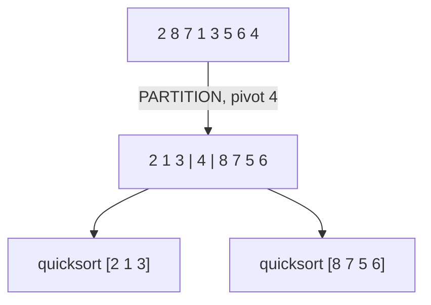

# Quicksort

## What it is
Quicksort is the workhorse sort of practice. Worst-case time is Θ(n²), yet its expected time is Θ(n lg n) with very small constants, and it sorts in place.

## How it works
Divide-and-conquer on the subarray `A[p..r]`:
1. **Partition** around the pivot `x = A[r]` so that elements `≤ x` come first, then `x`, then elements `> x` (the Lomuto scheme the book uses from the 2nd edition on).
2. **Recurse** on the two sides. There is no combine step.

Partition loop invariant: `A[p..i]` ≤ pivot, `A[i+1..j-1]` > pivot, `A[r]` = pivot.

## Complexity
| Case | Time |
|---|---|
| Best / balanced split | Θ(n lg n) — `T(n)=2T(n/2)+Θ(n)` |
| Worst (sorted input with last-element pivot) | Θ(n²) — `T(n)=T(n−1)+Θ(n)` |
| Expected (random pivots) | Θ(n lg n) |

Even a constant-proportion split such as 9-to-1 gives Θ(n lg n). See [randomized quicksort](#/randomized_quicksort) for how randomness removes bad inputs.

## When to use it
General-purpose in-memory sorting. Use [heapsort](#/heapsort) or [merge sort](#/merge_sort) if you need a hard worst-case guarantee or stability.

## In this implementation
Slice-based recursion with `split_at_mut`; `partition` returns the pivot's final index. The book's Figure 7.1 example is a test.
