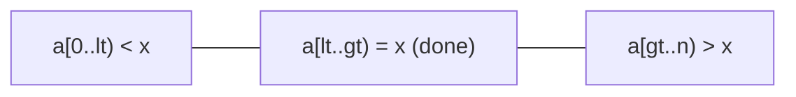

# Quicksort Variants

## What it is
Three improvements to [quicksort](#/quicksort) that the book develops as problems.

## How it works
**Problem 7-2 — equal elements (three-way partition).** Partition into `< x`, `= x`, `> x` and recurse only on the strict sides. Inputs with many duplicate keys then run in Θ(n) instead of Θ(n²).

**Problem 7-4 — stack depth.** `TAIL-RECURSIVE-QUICKSORT` recurses on the *smaller* side and loops on the larger side. The stack depth is then at most `⌊lg n⌋ + 1` even when the partitions are lopsided (the naive version needs Θ(n) stack on sorted input).

**Problem 7-5 — median-of-3.** Use the median of three sampled elements as pivot. This makes the bad-split probability smaller and improves the expected constant by about 5% (the analysis uses order-statistic probabilities `6(i−1)(n−i)/(n(n−1)(n−2))`).

## Complexity
Expected Θ(n lg n) as for quicksort; three-way is Θ(n + n·H) where `H` is the entropy of the key distribution; tail-recursive uses O(lg n) stack.

## When to use it
Production sorters combine all three ideas (introsort adds a heapsort fallback; `pdqsort` uses pattern detection). Three-way partitioning matters whenever keys repeat.

## In this implementation
`quicksort_three_way`, `quicksort_tail_recursive` (returns the maximum stack depth, tested ≤ 20 for 50 000 sorted keys), and `quicksort_median_of_three`.
