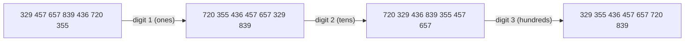

# Radix Sort

## What it is
Radix sort is the algorithm behind old punched-card sorting machines. It sorts `n` numbers of `d` digits (each digit has up to `k` values) in Θ(d(n + k)) time by sorting on one digit at a time.

## How it works
Sort by the **least significant digit first**, using a **stable** sort ([counting sort](#/counting_sort)) for each pass. Stability guarantees that earlier passes act as tie-breakers for later ones.

For `b`-bit keys split into `r`-bit digits the cost is `Θ((b/r)(n + 2ʳ))`; the best choice is `r ≈ lg n`, giving Θ(bn / lg n) — linear for keys of `O(lg n)` bits, or Θ(n) for keys in `0…n^c`.

## Complexity
Θ(d(n + k)) time, Θ(n + k) extra space.

## When to use it
Fixed-width integer keys, IP addresses, dates (Exercise 8.3-1), fixed-length strings, suffix-array construction. Not suited to variable-length keys without padding.

## In this implementation
`radix_sort(a, base)` supports any base ≥ 2 (tests use 2, 10, 16, 256 and 1000); `radix_sort_strings` pads with zero bytes and reuses the stable counting sort.
