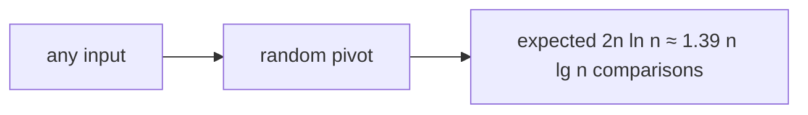

# Randomized Quicksort

## What it is
Deterministic quicksort has a Θ(n²) worst case on inputs such as already-sorted arrays. Section 7.3 fixes that with randomisation: choose the pivot uniformly at random, so no *input* is bad — only unlucky coin flips are.

## How it works
`RANDOMIZED-PARTITION` swaps `A[r]` with a random `A[i]`, `p ≤ i ≤ r`, and calls the ordinary [`PARTITION`](#/quicksort).

**Expected-time analysis (Section 7.4.2).** Let `X` be the total number of comparisons and `Xᵢⱼ` indicate that the `i`-th and `j`-th smallest elements are ever compared. They are compared iff one of them is the first pivot chosen from `{zᵢ,…,zⱼ}`, which happens with probability `2/(j−i+1)`. Hence

`E[X] = Σᵢ Σⱼ 2/(j−i+1) = O(n lg n)`.

## Complexity
Expected Θ(n lg n) for every input; the worst case remains Θ(n²) but occurs with negligible probability.

## When to use it
Whenever inputs may be adversarial or pre-sorted. The same idea gives [randomized select](#/randomized_select) for order statistics.

## In this implementation
Uses the deterministic project RNG; `comparisons` counts comparisons so the run log can show sorted input costing about `2n ln n`.
