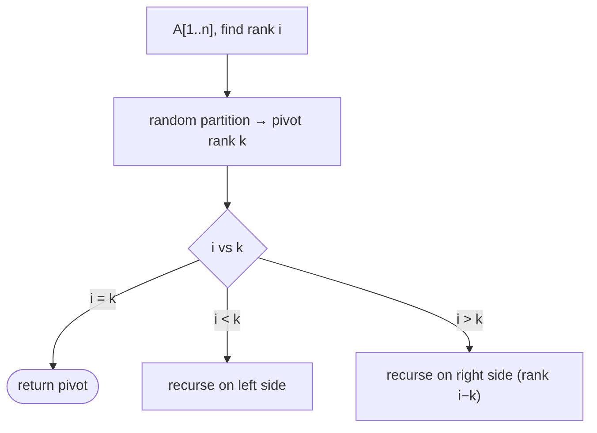

# Randomized Select

## What it is
The **i-th order statistic** of a set is its i-th smallest element (the minimum is the 1st, the median about the `n/2`-th). Sorting solves the problem in Θ(n lg n); `RANDOMIZED-SELECT` solves it in **expected Θ(n)** by partitioning like [randomized quicksort](#/randomized_quicksort) but recursing into only one side.

## How it works
1. Partition around a random pivot; let `k` be the pivot's rank.
2. If `i = k` return the pivot; if `i < k` recurse on the left part; otherwise recurse on the right part looking for rank `i − k`.

Expected running time: `T(n) ≤ (2/n) Σ_{k ≥ n/2} T(k) + O(n)` solves to `O(n)`.

## Complexity
Expected Θ(n); worst case Θ(n²) with unlucky pivots (the deterministic [linear-time SELECT](#/select_linear_time) removes this).

## When to use it
Medians, percentiles, top-k thresholds, and as the core of `nth_element` in many standard libraries.

## In this implementation
Reuses `randomized_partition` from the quicksort module. The tests check every rank 1…n against a sorted copy.
