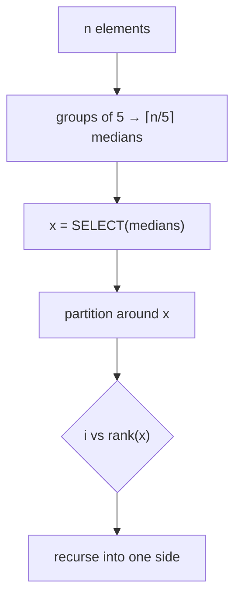

# Selection in Worst-Case Linear Time

## What it is
Blum, Floyd, Pratt, Rivest and Tarjan (1973) showed that the i-th smallest of `n` elements can be found in **Θ(n) worst-case time**, with no randomness. CLRS presents it in Section 9.3; Rivest is a co-author of both the algorithm and the book.

## How it works
1. Divide the `n` elements into `⌈n/5⌉` groups of 5 and find each group's median by insertion sort.
2. Recursively find the **median of medians** `x`.
3. Partition around `x`; let `k` be its rank.
4. If `i = k` return `x`; otherwise recurse into the side containing the answer.

At least `3n/10 − 6` elements are `≤ x` and as many are `≥ x`, so the recursive call is on at most `7n/10 + 6` elements: `T(n) ≤ T(⌈n/5⌉) + T(7n/10 + 6) + O(n)`. Since `1/5 + 7/10 < 1` this solves to `T(n) = O(n)` (see [Akra–Bazzi](#/akra_bazzi)).

## Complexity
Θ(n) worst case; the constant is large, so randomized select is usually faster in practice. With groups of 3 the recurrence becomes `T(n/3)+T(2n/3)` ⇒ Θ(n lg n); groups of 7 also work.

## When to use it
When a hard linear worst-case bound is needed — e.g. as the pivot rule that makes quicksort Θ(n lg n) worst case (Exercise 9.3-3), or for weighted medians ([next](#/weighted_median)).

## In this implementation
Handles duplicate keys by three-way partitioning (`<`, `=`, `>` pivot) and is tested against sorting for all ranks.
