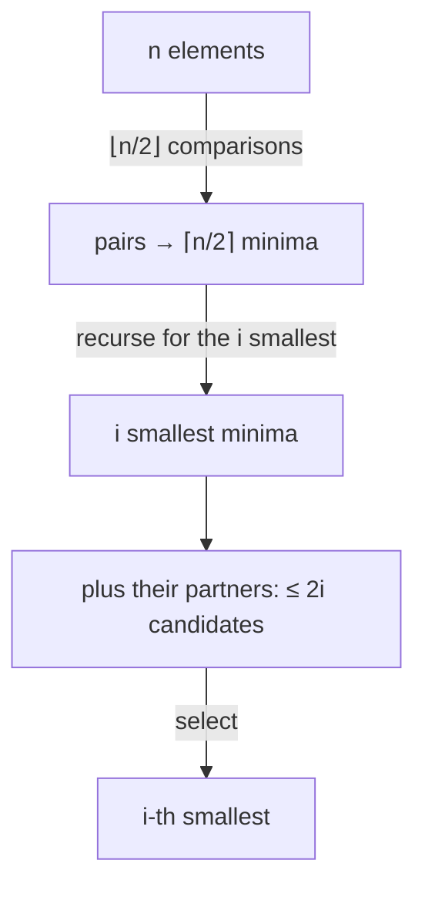

# Selecting Small Order Statistics

## What it is
[Selection](#/select_linear_time) finds the `i`-th smallest of `n` elements in linear time, but the constant is large. For *small* `i` (the minimum, the second smallest, the 10 smallest…) one can do much better in terms of **comparisons**: Problem 9-3 asks you to show that the `i`-th smallest can be found with `U_i(n) = n + O(i lg(n/i))` comparisons — close to the `n − 1` needed for the minimum. [Tournament selection](#/tournament_selection) gets `n + ⌈lg n⌉ − 2` for `i = 2`.

## How it works
1. **Pair up** the elements and compare each pair (`⌊n/2⌋` comparisons). Call the smaller element of a pair its *minimum*.
2. **Recurse:** find the `i` smallest of the `⌈n/2⌉` pair minima.
3. **Candidates.** The `i`-th smallest overall is among those `i` minima and their pair *partners* — at most `2i` elements: any other element has at least `i` smaller elements (its own pair minimum, if it is a partner, plus the `i` smaller minima, or it is a larger minimum). Select the `i`-th among the `≤ 2i` candidates directly.

If `i ≥ n/2` just use ordinary selection. The recurrence `U_i(n) = ⌊n/2⌋ + U_i(⌈n/2⌉) + T(2i)` (with `T` a selection cost on `2i` elements, `O(i lg i)`) unrolls to `n + O(i lg(n/i))`.

## Complexity
`n + O(i lg(n/i))` comparisons, versus `Θ(n)` with a larger constant for [median-of-medians](#/select_linear_time) and `n lg n` for sorting.

## When to use it
Top-`k` queries with small `k` where comparisons are expensive (human or model comparisons, remote calls); the same pairing idea powers the `n + ⌈lg n⌉ − 2` bound for the second smallest.

## In this implementation
Items are `(value, id)` pairs so ties are impossible. Comparisons are counted explicitly (including the candidate-membership tests). Tests compare with `std` sorting for `i ≤ 12` on 300 random inputs, and verify empirical comparison budgets for `n = 4096` and `i = 1, 4, 16`.
