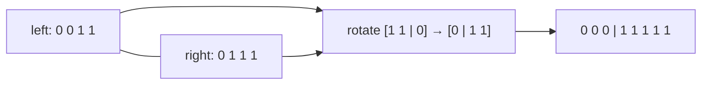

# Sorting in Place in Linear Time

## What it is
Suppose `n` records have keys that are all `0` or `1`. Problem 8-2 lists three desirable properties for a sorting algorithm: (a) it runs in `O(n)` time, (b) it is **stable**, (c) it sorts **in place** (using only `O(1)` extra storage besides the input array). It asks which of the standard sorts have which properties, and whether all three can be had together.

## How it works
* **Counting sort** ([Section 8.2](#/counting_sort)) is linear and stable but needs an output array: `(a)` and `(b)`, not `(c)`.
* **Partition** (the loop of [quicksort](#/quicksort), here with two pointers): scan from the left for a `1` and from the right for a `0`, swap them, repeat — linear and in place, but swapping distant records destroys the order of equal keys: `(a)` and `(c)`, not `(b)`.
* **Insertion sort** is stable and in place but quadratic; [merge sort](#/merge_sort) stable and `O(n lg n)` but needs `Θ(n)` extra space; [heapsort](#/heapsort) in place `O(n lg n)` but unstable.
* **Stable and in place:** sort the two halves recursively, then fix the middle: the left half ends with a block of `1`s and the right half starts with a block of `0`s; exchanging the two blocks by a *rotation* (three reversals, `O(n)`) preserves the relative order inside each block. This gives `(b)` and `(c)` in `O(n lg n)`; linear-time algorithms achieving all three simultaneously exist but use more elaborate block-swapping.

## Complexity
Partition `O(n)` time, `O(1)` space, unstable; counting `O(n)` time, `O(n)` space, stable; rotation recursion `O(n lg n)` time, `O(lg n)` stack, stable.

## When to use it
Partitioning arrays on a boolean predicate (`std::stable_partition` uses exactly such a divide-and-conquer with rotations when no buffer is available), and as the cleanest illustration that stability, space and time trade off against one another.

## In this implementation
Records carry an `id` so stability is observable. Tests check, on 500 random 0/1 arrays, that all three algorithms sort; that counting sort and the rotation sort are stable and agree exactly; and that the partition sort is not stable on at least one input.
