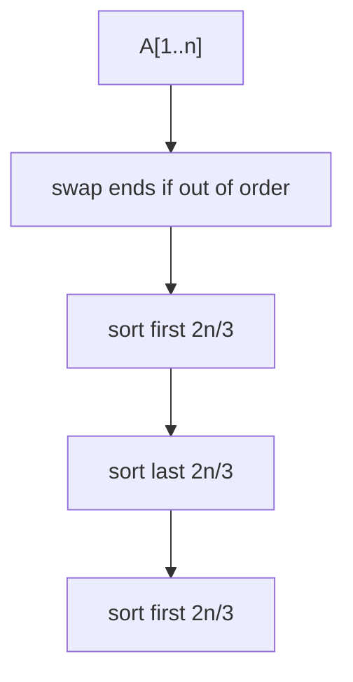

# Stooge Sort

## What it is
Professor Howard, Fine and Howard propose **STOOGE-SORT** in Problem 7-3: a cute but terrible algorithm named after the Three Stooges. Its purpose is to practise proving correctness of a recursion and solving a recurrence.

## How it works
1. If the first element is larger than the last, swap them.
2. If there are at least three elements, sort the first ⌈2n/3⌉, then the last ⌈2n/3⌉, then the first ⌈2n/3⌉ again.

Correctness: after step 2a the largest `n/3` elements must end up in the last third because the second pass puts them there and the first/third passes fix the rest.

## Complexity
`T(n) = 3T(2n/3) + Θ(1)` ⇒ `Θ(n^(log_{3/2} 3)) = Θ(n^2.71)` — slower than insertion sort.

## When to use it
Never, except to illustrate how an elegant-looking recursion can still be slow, and as a master-theorem exercise ([case 1](#/master_theorem)).

## In this implementation
The recursion uses sizes `n − ⌊n/3⌋ = ⌈2n/3⌉`; `calls(n)` reproduces the call-count recurrence for the run log.
