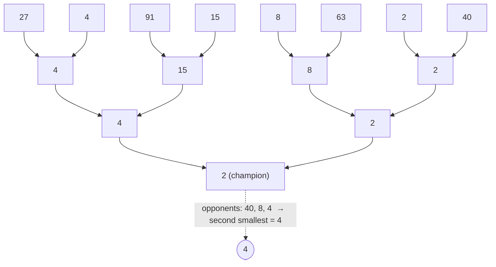

# Second Smallest via a Tournament

## What it is
Section 9.1 shows `n − 1` comparisons are necessary and sufficient to find the minimum — every element except the winner must lose at least once. Exercise 9.1-1 asks for the **second smallest** with only `n + ⌈lg n⌉ − 2` comparisons, which is optimal.

## How it works
Run a **knockout tournament**: pair up elements, the smaller advances, repeat until one champion remains (`n − 1` comparisons). The second smallest must have been beaten **directly by the champion** — otherwise whoever beat it would be smaller and the champion could not be the minimum of the remainder. The champion played only `⌈lg n⌉` matches, so the runner-up is the minimum of these `⌈lg n⌉` opponents: `⌈lg n⌉ − 1` more comparisons.

## Complexity
`n + ⌈lg n⌉ − 2` comparisons (matching the information-theoretic lower bound); `Θ(n)` time. Generalises to the i-th smallest via a heap-ordered tournament (Section 9.1 exercises), e.g. in external merging of sorted runs.

## When to use it
Selecting a few extremes with the fewest comparisons, ranking in tournaments or sports brackets, and as an example of an adversary argument being tight. For arbitrary ranks use [randomized select](#/randomized_select) or [SELECT](#/select_linear_time).

## In this implementation
Each winner keeps the list of elements it beat; tests verify correctness and the exact comparison bound for all `n` from 2 to 199.
