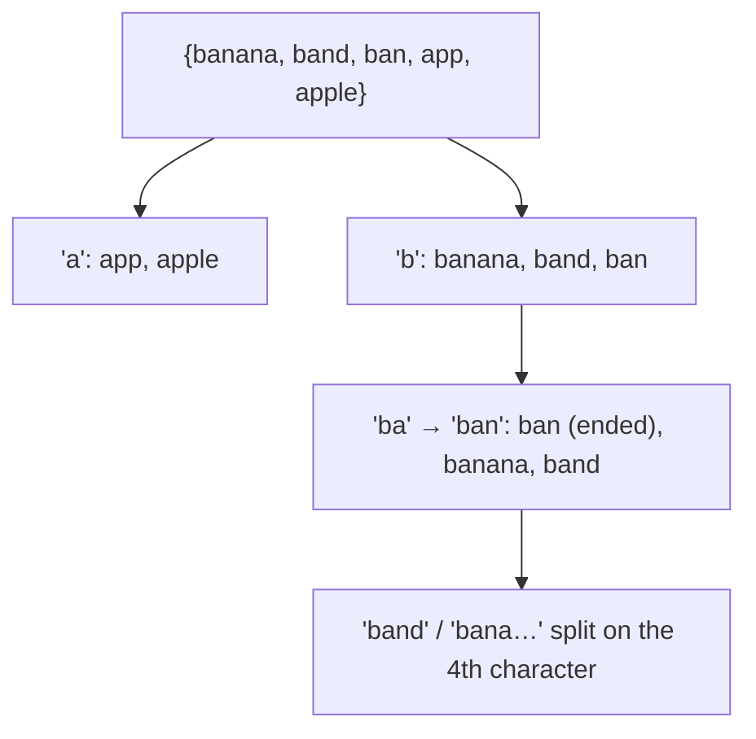

# Sorting Variable-Length Items

## What it is
[Radix sort](#/radix_sort) assumes all keys have the same number of digits. Problem 8-3 removes that assumption: sort `n` integers whose digit counts differ (total of `n` digits **overall**, not per key), and sort a set of strings whose **total length** is `n`, each in `O(n)` time. A naive padding of every key to the maximum length would cost `n × max length`, which can be quadratic.

## How it works
* **Integers.** A number with fewer digits is smaller, so first group the keys by digit count with a [counting sort](#/counting_sort) (`O(count + max digits)`). Then radix-sort each group separately; a group with `d` digits and `m` keys costs `O(d·m)` — exactly its digit count. The sum over groups is the total number of digits, `O(n)`.
* **Strings.** Use **most-significant-character radix sort**: split the set by first character into buckets (strings equal to the prefix so far, i.e. already finished, go first), then recurse on each bucket with the next character. A character is touched only while the string is still tied with others, so the work is bounded by the total length plus the bucket scans — `O(n)` for a fixed alphabet. This is the idea behind the *burstsort* and trie-based sorts.

## Complexity
`Θ(total digits)` for integers; `Θ(total length + σ · buckets visited)` for strings over an alphabet of size `σ`.

## When to use it
Sorting words, URLs and file names; the integer variant sorts big numbers stored as digit strings; MSD radix sort is the basis of the fastest string sorts in practice.

## In this implementation
Integers are handled in decimal with buckets of 10; strings are byte arrays with 256 buckets. Tests compare both sorters with `std` on 200 random inputs each, including empty strings and strings that are prefixes of each other.
