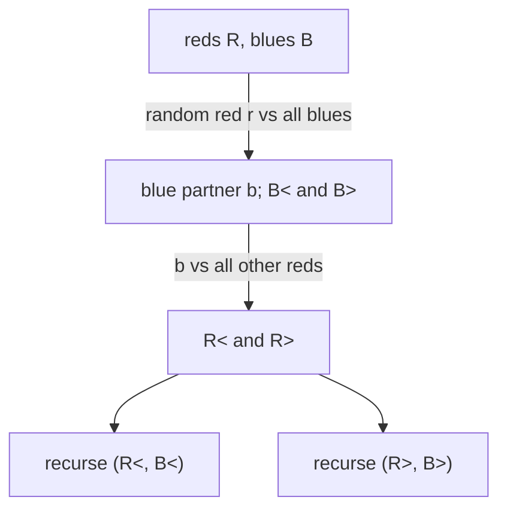

# Matching Water Jugs

## What it is
A collection of `n` red and `n` blue water jugs; every red jug has a blue partner holding exactly the same volume, but the jugs look alike, so the **only** allowed operation is to pour: compare a *red* jug with a *blue* jug and learn whether the red one is smaller, equal or larger. There is no way to compare two jugs of the same colour. Problem 8-4 asks (a) for a brute-force matching, (b) for an `Ω(n lg n)` lower bound on comparisons, and (c) for a randomized algorithm with `O(n lg n)` expected comparisons.

## How it works
* **Lower bound.** The decision tree must have at least `n!` leaves (one per matching), so its height is `Ω(lg n!) = Ω(n lg n)` — the same argument as for [comparison sorting](#/decision_tree_lower_bound).
* **Algorithm — a two-sided quicksort.** Pick a random red jug `r`. Compare it with every blue jug: this splits the blue jugs into smaller / equal / larger and finds `r`'s partner `b`. Now compare `b` with every other red jug to split the red jugs the same way. Recurse on the (smaller reds, smaller blues) and (larger reds, larger blues) halves, which have equal size on both sides.

The expected work is the same recurrence as [randomized quicksort](#/randomized_quicksort): `Θ(n lg n)`. A deterministic `O(n lg n)` algorithm exists but is far more complicated (Komlós–Ma–Szemerédi, via expanders); the worst case of the randomized one is `Θ(n²)`.

## Complexity
Expected `Θ(n lg n)` comparisons (about `2 n ln n`), worst case `Θ(n²)`; lower bound `Ω(n lg n)`.

## When to use it
Matching objects that can only be compared across two groups: nuts and bolts, keys and locks, adapters and sockets.

## In this implementation
Tests verify on sizes 1…1000 that every returned pair has equal capacity, that each jug is used exactly once, and that the comparison count stays under `6 n lg n`.
