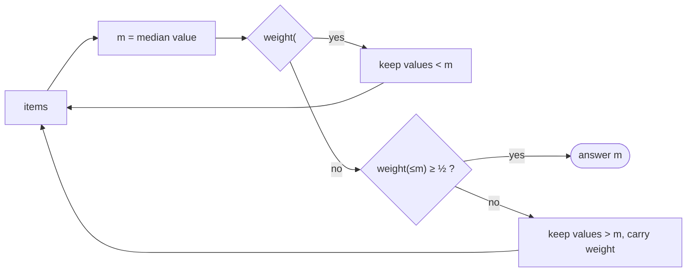

# Weighted Median

## What it is
For distinct elements `x₁…xₙ` with positive weights `w₁…wₙ` summing to 1, the **weighted (lower) median** is the element `xₖ` such that the weight of the smaller elements is `< ½` and the weight of the larger elements is `≤ ½`. With equal weights it is the ordinary median. Problem 9-2 covers it, together with its application to the **1-D post-office location problem**: placing a post office at the weighted median minimises total weighted distance to all points.

## How it works
* **Sorting:** sort by value, accumulate weights until the running total first reaches half.
* **Linear time:** find the median value `m` with [SELECT](#/select_linear_time); compute the weight below and at `m`; if the lower side already has half the weight, discard `m` and everything above; if adding `m` still falls short, discard `m` and everything below (remembering the weight removed) — each round halves the input, so total work is `T(n) = T(n/2) + Θ(n) = Θ(n)`.

## Complexity
Θ(n lg n) by sorting; Θ(n) worst-case with linear-time select.

## When to use it
Facility location on a line, robust statistics (weighted percentiles), minimising `Σ wᵢ|x − xᵢ|`.

## In this implementation
Weights are integers to avoid floating-point comparison issues (`2·cum ≥ total` replaces `cum ≥ ½`); the two implementations are cross-checked on random inputs.
