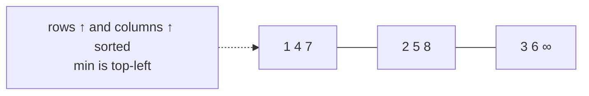

# Young Tableaux

## What it is
An `m × n` **Young tableau** is a matrix whose entries increase along every row and down every column; unused cells hold `∞`. Problem 6-3 shows that it behaves like a priority queue that needs no pointers: the smallest element is always the top-left corner.

## How it works
* **EXTRACT-MIN** — take `Y[1,1]`, put `∞` there and let it "sink": repeatedly swap with the smaller of the right and lower neighbour. O(m+n).
* **INSERT** — put the new key in the bottom-right (empty) cell and let it "float" up/left past larger neighbours. O(m+n).
* **Membership** — start at the top-right corner; if the entry is too big go left, if too small go down. O(m+n).
* **Sorting** — insert `n²` numbers into an `n×n` tableau, then extract them all: O(n³) = O(N^1.5) for N numbers.

## Complexity
Insert / extract-min / search: O(m+n). Sorting `n²` elements: O(n³).

## When to use it
Mostly instructive: it shows how two-dimensional order structure gives a sublinear priority queue. Young tableaux also appear in combinatorics and representation theory (RSK correspondence, longest increasing subsequences).

## In this implementation
`INF = i64::MAX` is the "empty" marker; tests verify the row/column invariant after every operation.
