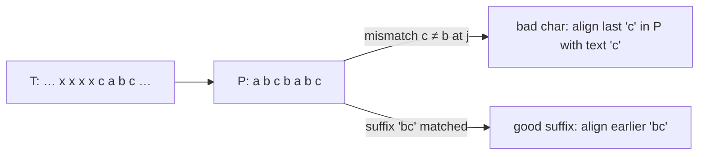

# Boyer-Moore Algorithm

## What it is
Boyer and Moore (1977) noticed that comparing the pattern **right to left** allows large skips: a mismatch near the end of the pattern says a lot about where it could possibly match. In practice the algorithm is *sublinear* — it often examines only about `n/m` text characters — which makes it the fastest general-purpose matcher for long patterns over large alphabets. It was covered in Section 34.5 of the first edition (the second edition removed it).

## How it works
Align the pattern at shift `s`, compare from the last character backwards. On a mismatch (or after a full match) slide the pattern by the larger of two heuristics:

* **Bad-character heuristic**: if the text character `c` that caused the mismatch at pattern position `j` occurs last at position `λ[c]` in `P`, shift by `max(1, j − λ[c])` so that `P[λ[c]]` lines up with it (or past it if `c ∉ P`).
* **Good-suffix heuristic**: after matching a suffix `P[j+1..m]`, shift to the next position where this suffix occurs in `P` preceded by a *different* character (or where a prefix of `P` matches a tail of the suffix). Preprocessing via the border array takes `O(m)`.

## Complexity
Preprocessing `O(m + |Σ|)`. Worst case `O(nm)` with only the bad-character rule, `O(n + m)` with the (strong) good-suffix rule if the pattern does not occur; best case `Θ(n/m)`.

## When to use it
`grep`, text editors' find, intrusion detection with long signatures. For short patterns or small alphabets (DNA) [KMP](#/kmp) or Horspool's simplification are competitive.

## In this implementation
Both tables and the matcher count character comparisons, so the demo shows sublinear scanning. Random periodic patterns over tiny alphabets are compared with the naive matcher.
