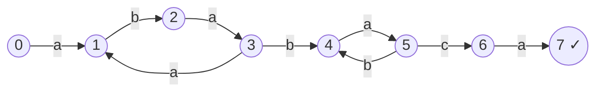

# String Matching with Finite Automata

## What it is
Many matchers can be seen as **finite automata**. For a pattern `P` of length `m` the *string-matching automaton* has states `0, 1, …, m` (state `q` means "the last `q` characters read equal `P[1..q]`"; the longest such `q`), start state 0 and accepting state `m`. Reading the text through the automaton reports every match with **one pass and one table look-up per character**.

## How it works
The transition function is `δ(q, a) = σ(P_q a)`, where `σ(x)` is the length of the longest prefix of `P` that is a suffix of `x`.

Building it naively costs `O(m³|Σ|)`; the book's COMPUTE-TRANSITION-FUNCTION does it in `O(m³|Σ|)` and a refined version reaches `O(m|Σ|)` by noting that `δ(q, a) = δ(π(q), a)` for the mismatching letters — reuse the row of the "restart state" `X`:

`δ[q] = δ[X]` (copy), then `δ[q][P[q+1]] = q + 1`, and `X = δ[X][P[q+1]]`.

(Automaton for `ababaca`, Figure 32.7; unlabeled transitions go to state 0 or 1.)

## Complexity
Preprocessing `O(m|Σ|)` time and space; matching `Θ(n)` — the cleanest of all matchers (one table access per text character, no backtracking). [KMP](#/kmp) does the same matching with only `Θ(m)` preprocessing/space using the prefix function.

## When to use it
Small alphabets (DNA, bits), lexical analysers (`lex`), network intrusion detection, and multi-pattern matching generalised as the Aho–Corasick automaton.

## In this implementation
A `[usize; 256]` row per state; the automaton for `ababaca` matches Figure 32.7 exactly (tested), and matches are compared with the naive matcher on random strings.
