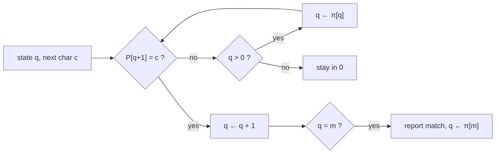

# Knuth-Morris-Pratt Algorithm

## What it is
KMP (Knuth, Morris, Pratt 1977) matches strings in linear time without ever moving backwards in the text and without the `O(m|Σ|)` table of the [automaton matcher](#/finite_automaton_matcher). Its single precomputed array is the **prefix function** `π`.

## How it works
`π[q]` is the length of the longest proper prefix of `P[1..q]` that is also a suffix of `P[1..q]`. Equivalently the automaton transition after a mismatch in state `q` can be taken from state `π[q]`: on mismatch, *fall back* `q ← π[q]` until the next character matches or `q = 0`. The set of fall-backs `π[q], π[π[q]], …` is exactly all borders of `P[1..q]`.

**Linear time by amortised analysis**: `q` increases by at most 1 per text character and every fall-back strictly decreases it, so the total number of fall-backs is ≤ `n` (the potential function is `q`). The same argument shows `COMPUTE-PREFIX-FUNCTION` takes `Θ(m)`. For `P = ababaca`: `π = ⟨0,0,1,2,3,0,1⟩`.

## Complexity
Preprocessing `Θ(m)`, matching `Θ(n)`, space `Θ(m)`. `m − π[m]` is the smallest period of `P`.

## When to use it
Streaming text (no look-behind), periodicity/border problems, building blocks of Z-algorithm and Aho–Corasick, and as a model example of amortised analysis (compare [MULTIPOP](#/multipop_stack)).

## In this implementation
0-based prefix function and matcher, `smallest_period`; random binary strings (maximising overlaps) are checked against the naive matcher.
