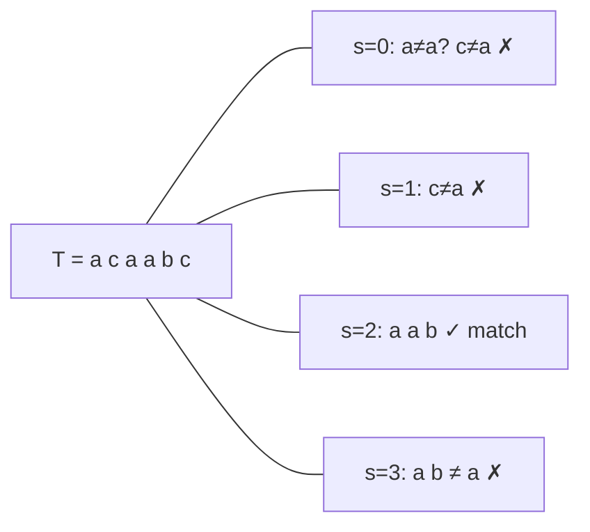

# Naive String Matching

## What it is
The **string-matching problem**: given a text `T[1..n]` and a pattern `P[1..m]` over an alphabet Σ, find all **valid shifts** `s` such that `T[s+1..s+m] = P`. Chapter 32 presents several algorithms; the naive one is the baseline.

## How it works
Slide the pattern across the text and compare character by character at each of the `n − m + 1` possible shifts.

It wastes information: after a mismatch at shift `s`, it forgets everything learned about the text. Worst case: `T = aⁿ`, `P = aᵐ⁻¹b` forces `m` comparisons at every shift.

## Complexity
Matching time `Θ((n − m + 1)m)`, no preprocessing, O(1) space. The later algorithms — [Rabin–Karp](#/rabin_karp), [finite automata](#/finite_automaton_matcher), [KMP](#/kmp) — improve on this to `Θ(n + m)`.

## When to use it
Short patterns or texts, one-off searches where simplicity wins (and where the library's `memchr`/SIMD routines do the heavy lifting).

## In this implementation
Returns every shift (overlapping matches included); `comparisons` counts character comparisons to verify the `(n − m + 1)m` worst case.
