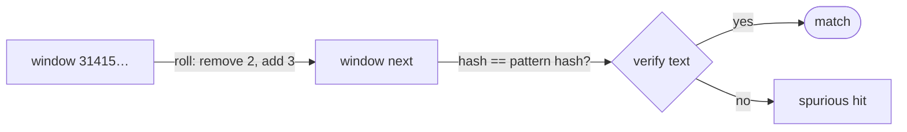

# Rabin-Karp Algorithm

## What it is
Rabin and Karp (1987) speed up string matching by comparing **numbers** rather than strings. Treat each length-`m` window of the text as a `d`-ary number and compare it with the pattern's value; because comparing machine words is O(1), the only work per shift is updating the number.

## How it works
Let `p` = value of `P` and `tₛ` = value of `T[s+1..s+m]`, both modulo a prime `q`. The next window's value follows from the current one in O(1) — a **rolling hash** (Horner's rule + adjusting the leading digit):

`t_{s+1} = ( d·(tₛ − T[s+1]·h) + T[s+m+1] ) mod q`, with `h = d^{m−1} mod q`.

If `p ≢ tₛ` the window cannot match. If `p ≡ tₛ` it *might*: verify character by character (a **spurious hit** if not equal). With a random large prime the expected number of spurious hits is `O(n/q)`.

## Complexity
Preprocessing `Θ(m)`; matching `Θ((n − m + 1)m)` worst case but **expected `O(n + m)`** with `q ≥ m`.

## When to use it
Multiple-pattern search (hash all patterns in a set), plagiarism detection, 2-D pattern matching in images, content-defined chunking (rsync, deduplication), and as the intuition for polynomial rolling hashes ([Horner](#/horner)).

## In this implementation
Base 256 over bytes; the demo contrasts a tiny prime (many spurious hits) with a large one. The book's Figure 32.5 (`q = 13`) is a test; random strings are compared with the [naive matcher](#/naive_string_matcher).
