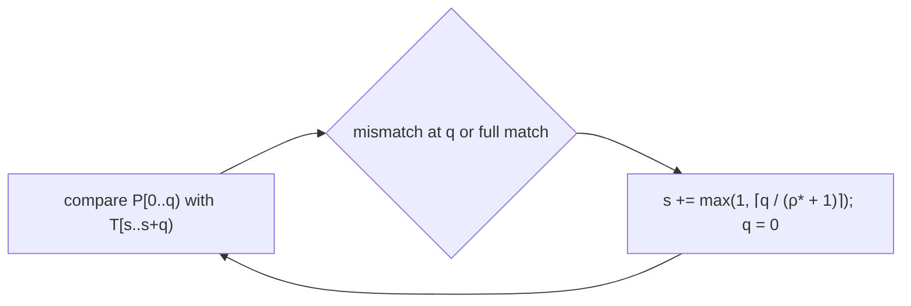

# Repetition Factor and the Repetition Matcher

## What it is
For strings `x` and `y`, write `xʳ` for `x` concatenated `r` times. The **repetition factor** `ρ(y)` is the largest `r` such that `y = xʳ` for some string `x`. For instance `ρ(abababab) = 4`, `ρ(abaab) = 1`. Problem 32-1 asks (a) for an `O(|y|)` algorithm for `ρ(y)`, (b) for `ρ*(P) = max_k ρ(Pₖ)` over the prefixes `Pₖ` of a pattern, and (c) to show that the **repetition matcher** is a correct string matcher.

## How it works
* **ρ(y).** The [prefix function](#/kmp) gives the smallest period `p = n − π[n]`. If `p` divides `n` the string is `(n/p)` copies of its first `p` characters; otherwise it is not a power and `ρ(y) = 1`.
* **ρ\*(P)** is the maximum of that value over all prefixes, obtained in the same pass.
* **REPETITION-MATCHER.** Align the pattern at shift `s`, compare left to right, and stop at the first mismatch (position `q`) or at a full match. Then advance `s` by `max(1, ⌈q/(ρ* + 1)⌉)`. Why the jump is safe is the content of Problem 32-1(c) and is not re-proved here; this repository checks it empirically against the naive matcher (see the tests). It is simple and uses only `O(1)` extra space — handy when the pattern is highly periodic.

## Complexity
`ρ`, `ρ*`: `O(m)`. Matching: `O(n/ρ* + …)` comparisons per phase; worst case `O(n·m)` for patterns with `ρ* = 1`, while for highly repetitive patterns (large `ρ*`) it skips ahead aggressively. It is not linear in general — [KMP](#/kmp) or [Boyer–Moore](#/boyer_moore) are the robust choices.

## When to use it
Teaching the structure of periodic strings; quick matching of highly periodic patterns such as `ababab…`; computing the primitive root of a string (the smallest `x`).

## In this implementation
Tests check `ρ` against its definition on 300 random binary strings and the matcher against the naive matcher on 500 random pattern/text pairs over 2–4 letter alphabets.
