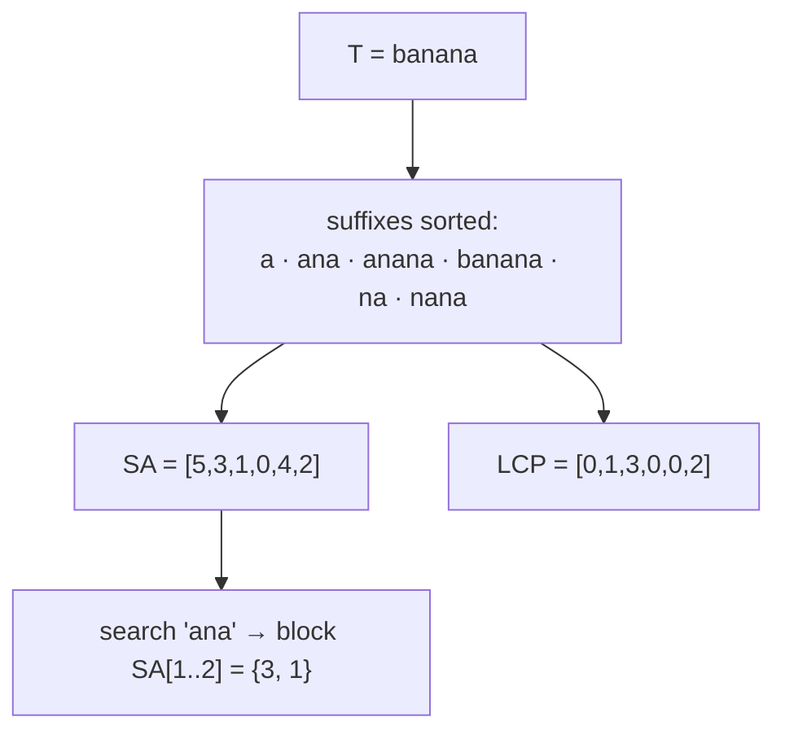

# Suffix Arrays & LCP Arrays

## What it is
The 4th edition adds **suffix arrays** to the string-matching chapter. The suffix array `SA` of a text `T` lists the starting positions of all suffixes in lexicographic order; the **longest-common-prefix array** `LCP` records how many leading characters adjacent suffixes share. Together they are a compact (`O(n)` space) alternative to suffix trees and index the text for *any* number of subsequent pattern queries.

## How it works
* **Construction by prefix doubling**: sort the suffixes by their first `k = 1, 2, 4, …` characters. The rank of a suffix by its first `2k` characters is determined by the pair (rank of first `k`, rank of the next `k`), so each round is one sort of pairs (a radix sort makes a round `O(n)`, total `O(n lg n)`). After `⌈lg n⌉` rounds all ranks are distinct.
* **Kasai's LCP algorithm**: visit suffixes in text order; if suffix `i` shares `h` characters with its predecessor in `SA`, suffix `i+1` shares at least `h − 1` with *its* predecessor — so `h` decreases by at most 1 per step and the total work is `O(n)`.
* **Search**: all occurrences of `P` form a contiguous block in `SA`; two binary searches find it in `O(m lg n)`.

The maximum LCP value gives the **longest repeated substring** (`abra` in `abracadabra`).

## Complexity
Construction `O(n lg n)` (this code: `O(n lg² n)` with comparison sorts); LCP `O(n)`; query `O(m lg n)`.

## When to use it
Full-text indexes, bioinformatics (genome alignment: BWA uses the related FM-index), data compression (Burrows–Wheeler transform), finding repeats and longest common substrings of two strings.

## In this implementation
`suffix_array` via sort of rank pairs, `lcp_array` (Kasai), `search`, and `longest_repeated_substring`. Tests compare with sorting all suffixes directly and with naive search on random strings.
