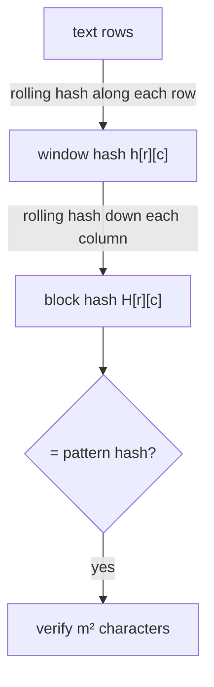

# Two-Dimensional Pattern Matching (Rabin-Karp)

## What it is
Given an `n × n` array of characters (an image, a game board, a map) and an `m × m` pattern array, find every position at which the pattern occurs as a contiguous block. Exercise 32.2-3 extends the [Rabin–Karp](#/rabin_karp) rolling hash to two dimensions.

## How it works
1. **Rows first.** For every row of the text compute the hash of every window of `m` consecutive characters with the usual rolling update `h' = d·(h − t·d^{m−1}) + t_new (mod q)`. This is `O(n²)` total. The pattern's own rows are hashed the same way.
2. **Columns next.** The `m` row-window hashes stacked in a column of the text form a sequence of `m` numbers; treat it as the digits of an `m`-digit number in base `d` and slide it down each column with the same rolling update — `O(1)` per position.
3. A position is a candidate if its combined hash equals the pattern's; **verify** the candidate character by character (needed for correctness because hashes can collide).

## Complexity
`O(n² + m²)` expected time with a good modulus; each false positive costs `O(m²)` for verification, and a match costs `O(m²)`, so `O(n² + k·m²)` for `k` matches.

## When to use it
Template matching in images and maps, finding sub-boards in games, and the same rolling-hash idea in plagiarism detection and rsync-style block matching (see also [multi-pattern matching](#/rabin_karp)).

## In this implementation
Modulus `10⁹ + 7` and base 257. Tests compare with the naive `O(n²m²)` search on 300 random small instances over 2–3 letter alphabets and with a planted random pattern in a 40×40 array.
